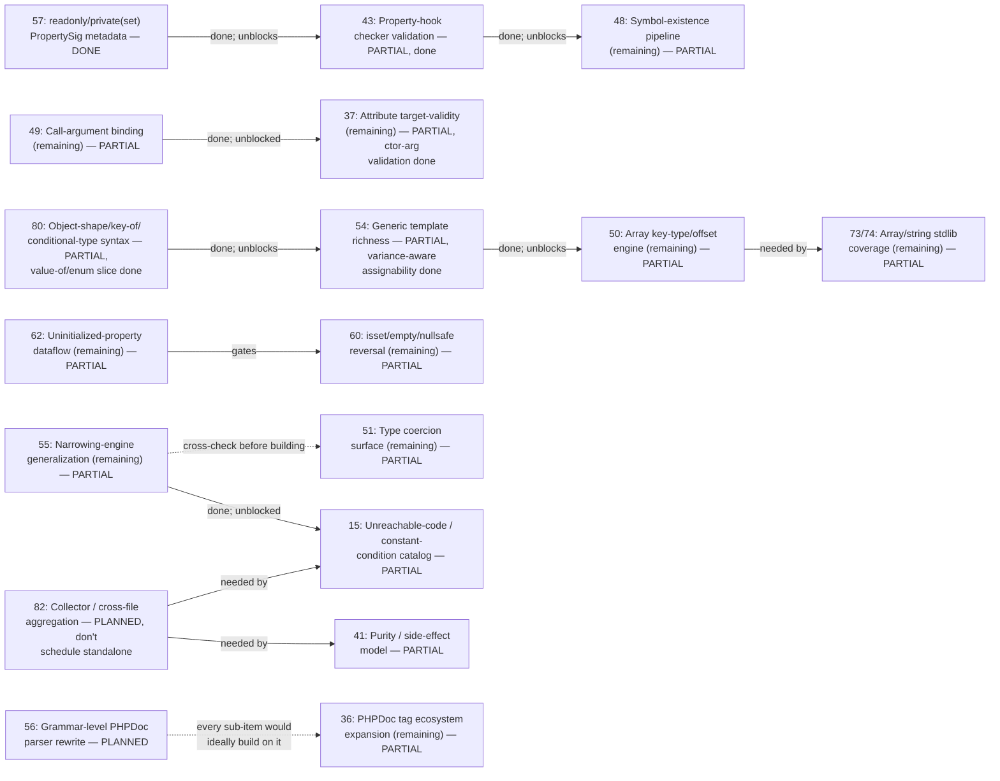

# Phase dependency graph

Extracted directly from every "needs Phase N" / "blocked on Phase N" /
"prerequisite for Phase N" / "cross-check against Phase N" statement in
`ROADMAP.md` (grep for `Phase [0-9]` and reviewed each hit in context - not
inferred). Most Pending phases have **no** dependency edge at all; only the
graph below and the "genuinely independent" list at the end are exhaustive.

Regenerate by re-grepping `ROADMAP.md` for `Phase [0-9]\+` after any
substantial edit - this file drifts the same way corpus counts do, and isn't
re-derived automatically.

## Graph

Solid arrows are hard blockers stated directly in ROADMAP.md ("needs",
"blocked on", "prerequisite for", "gates"). Dotted arrows are coordination
notes, not hard blocks (55↔51: don't reinvent range arithmetic twice; 56→36:
architectural nice-to-have, explicitly "not a hard blocker").

## Edge list (with source)

| From (satisfies) | To (blocked/helped) | Relationship | Status of the edge today |
|---|---|---|---|
| **57** readonly/private(set) `PropertySig` metadata | **43** Property-hook checker validation | prerequisite | 57 done → edge satisfied; 43 built the same session (picked as the first "unblocking" phase) |
| **43** Property-hook checker validation | **48**'s `ExistingClassesInPropertyHookTypehintsRule` | blocks | 43 done → edge satisfied for the existence-checking half (a `set` hook's own parameter type); 48's own entry now names the narrower remaining sub-checks (template-referenced-in-parameter, unresolvable native type, native union pre-8.0) directly, not as blocked on 43 |
| **49** Call-argument binding (remaining) | **37**'s attribute constructor-argument validation | needs | edge satisfied → `resolve_call_args`/`check_args` were already fully generic (no expr-node coupling), so 37's own "needs Phase 49's generalization" framing was stale; built directly, no new Phase 49 work needed |
| **54** Generic template richness | **50**'s reverted `InvalidKeyInArrayDimFetchRule` reattempt | blocks | 54's own stated blocker (`substitute_template`/`Registry::is_assignable`'s missing nested-generic-argument handling) is now fixed and shipped → **edge satisfied** - though the Reverted entry's own specific root cause (a used template parameter leaking as a bogus namespace-qualified class reference in a context with no registry access) wasn't independently re-verified as the same gap; a reattempt should re-check from scratch, not assume |
| **80** Object-shape/key-of/conditional-type syntax | **54**'s `TemplateKeyOfType`/`TemplateObjectShapeType` bound kinds | prerequisite | 80 done → edge satisfied for the specific deferred-resolution piece (`value-of<T>` naming a real enum, via `Registry::resolve_deferred_value_of`); `ClassInfo.template_bounds` is now walked and resolved, ready to build on - this specific bound-kind item is still open (54's own separate variance-aware-assignability work has since shipped in full, unrelated to this piece) |
| **50** Array key-type/offset engine (remaining) | **73/74**'s `array_key_exists` narrowing | needs | 50's `HasOffsetType`/`HasOffsetValueType` accessory facts not built → still blocked |
| **62** Uninitialized-property dataflow (remaining) | **60**'s offset/property-chain `isset($x['key'])` half | gates | 62's real dataflow not built → still blocked |
| **82** Collector / cross-file aggregation | **41**'s transitive purity across the call graph | needs | 82 explicitly PLANNED, "don't schedule standalone" → still blocked |
| **82** Collector / cross-file aggregation | **15**'s `FunctionCallConstantConditionRule` cross-file dedup | needs | same → still blocked |
| **55** Narrowing-engine generalization | **15** (original constant-boolean-condition family) | was the prerequisite | 55's fixed-point loop convergence shipped → **edge satisfied, 15 reinstated in full** (see Done) |
| **55** Narrowing-engine generalization (comparison-outcome/range API) | **51** IntegerRangeType work | coordinate, don't duplicate | both still open; explicitly flagged so whichever is built first doesn't reinvent range arithmetic |
| **56** Grammar-level PHPDoc parser rewrite | **36** PHPDoc tag ecosystem (every sub-item) | soft/architectural | 56 PLANNED; not a hard blocker, sub-items of 36 proceed independently today |

Six edges above are already satisfied (57→43, 43→48, 49→37, 54→50, 80→54,
55→15's original family) - kept in the graph because they explain *why*
43, 48's existence-check half, 37's constructor-argument validation, 50's
own reattempt, 54's own future template-bound kinds, and 15 are
buildable/built now, not because they're still live blockers.

**Investigated and removed: 51→76.** 76's own prior entry said its
`options` array `default`/`min_range`/`max_range` gap "needs Phase 51's
`IntegerRangeType` completion" - checked directly (at the user's own
request, before building) rather than assumed. The real prerequisite
(`normalize_int_range`/`int_range_bounds`, "build an int range from two
bounds") already existed, built by an unrelated phase (15, this same
session) - Phase 51's own actually-remaining item (range-preserving
`**`/shift arithmetic) has nothing to do with it. 76's own gap is now
built; 51's own item is still open, on its own, with no bearing on 76 at
all. A real example of why this file says "verify before trusting" a
prior write-up rather than mechanically propagating it forward.

## Genuinely independent (no dependency edge either direction)

Everything else in Pending/partial: **18, 19, 36's other sub-items, 39, 40,
42, 45, 46** (needs a `pcre2` binding - an external crate, not a phase),
**52, 53, 61, 63, 64** (blocked on an internal `PropertySig::ty_native`
split, not another phase), **67, 68, 69, 70, 71, 73/74's other sub-items,
75, 76** (its remaining scope - `filter_input()`, `FILTER_REQUIRE_ARRAY`/
`FILTER_FORCE_ARRAY`, PHP 8.4's `FILTER_THROW_ON_FAILURE` - needs no
other phase, confirmed above), **77, 78, 83, 84**. These can be picked up
in any order with respect to each other - their Pending entries name
*reasons* (low corpus incidence, size, deliberate scope trims) but never
another phase number as a blocker.
