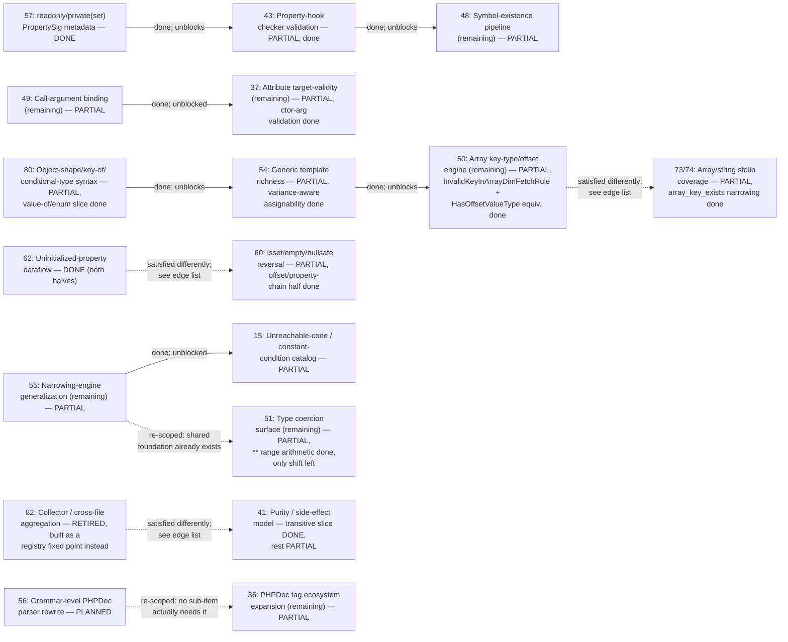

# Phase dependency graph

Extracted directly from every "needs Phase N" / "blocked on Phase N" /
"prerequisite for Phase N" / "cross-check against Phase N" statement in
`ROADMAP.md` (grep for `Phase [0-9]` and reviewed each hit in context - not
inferred). Most Pending phases have **no** dependency edge at all; only the
graph below and the "genuinely independent" list at the end are exhaustive.

Regenerate by re-grepping `ROADMAP.md` for `Phase [0-9]\+` after any
substantial edit - this file drifts the same way corpus counts do, and isn't
re-derived automatically.

## Graph

Solid arrows are hard blockers stated directly in ROADMAP.md ("needs",
"blocked on", "prerequisite for", "gates"). Dotted arrows are coordination
notes, not hard blocks (55↔51: checked directly against real PHPStan's own
mechanisms - genuinely separate consumers of the already-built `normalize_
int_range`/`int_range_bounds` primitives, nothing left to reinvent either
way; 56→36: checked directly against real `phpstan/phpdoc-parser`'s own
per-tag grammars - none of 36's remaining items actually needs 56 first,
each has its own small bounded grammar).

## Edge list (with source)

| From (satisfies) | To (blocked/helped) | Relationship | Status of the edge today |
|---|---|---|---|
| **57** readonly/private(set) `PropertySig` metadata | **43** Property-hook checker validation | prerequisite | 57 done → edge satisfied; 43 built the same session (picked as the first "unblocking" phase) |
| **43** Property-hook checker validation | **48**'s `ExistingClassesInPropertyHookTypehintsRule` | blocks | 43 done → edge satisfied for the existence-checking half (a `set` hook's own parameter type); 48's own entry now names the narrower remaining sub-checks (template-referenced-in-parameter, unresolvable native type, native union pre-8.0) directly, not as blocked on 43 |
| **49** Call-argument binding (remaining) | **37**'s attribute constructor-argument validation | needs | edge satisfied → `resolve_call_args`/`check_args` were already fully generic (no expr-node coupling), so 37's own "needs Phase 49's generalization" framing was stale; built directly, no new Phase 49 work needed |
| **54** Generic template richness | **50**'s reverted `InvalidKeyInArrayDimFetchRule` reattempt | blocks | 54's own stated blocker fixed and shipped → edge satisfied → **50's own reattempt built and shipped too, same session** (see Phase 50, Done) - though the real root cause found there (`Type::ObjectShape` missing from ten type-tree-walking functions; `Checker::resolve_type_hint` never applying `mark_template_params`) turned out unrelated to what 54 itself fixed, confirming the "re-verify, don't assume" caution was warranted |
| **80** Object-shape/key-of/conditional-type syntax | **54**'s `TemplateKeyOfType`/`TemplateObjectShapeType` bound kinds | prerequisite | 80 done → edge satisfied for the specific deferred-resolution piece (`value-of<T>` naming a real enum, via `Registry::resolve_deferred_value_of`); `ClassInfo.template_bounds` is now walked and resolved, ready to build on - this specific bound-kind item is still open (54's own separate variance-aware-assignability work has since shipped in full, unrelated to this piece) |
| **50** Array key-type/offset engine (remaining) | **73/74**'s `array_key_exists` narrowing | needs | **edge satisfied, differently than planned**: real PHPStan's own `HasOffsetType`/`HasOffsetValueType` accessory-type hierarchy was never actually needed - this project's own existing composite `narrowing_key` mechanism (`"arr[key]"`) was already the right, proportionate vehicle for the same fact. Built directly (`array_value_type_for_key`, `checker/narrowing.rs`; see Phase 50, Done) |
| **62** Uninitialized-property dataflow | **60**'s offset/property-chain `isset($x['key'])` half | gates | **edge satisfied, differently than planned, deliberately simplified**: 62's own `checker/uninitialized_dataflow.rs` was never exposed as a reusable per-statement fact, and doing so was judged disproportionate for one sub-case of one sub-case (re-architecting a one-shot walker into general-purpose narrowing-engine machinery). Built directly instead as a new recursive link-walker (`Checker::resolve_always_exists`, `checker/expr.rs`) mirroring real PHPStan's own `IssetabilityDescriptor` chain-walking shape - the offset link reuses Phase 50's own `array_value_type_for_key`/`narrow_array_shape_by_key_presence` (already a type-level query, no new dataflow needed); the property link substitutes a simplified, safe-direction static gate (`PropertySig::has_default`) for real PHPStan's own flow-sensitive `isInitializedThisProperty` fact, deliberately not replicating that exact sub-case (see Phase 60, Done) |
| **82** Collector / cross-file aggregation | **41**'s transitive purity across the call graph | needs | **edge satisfied, differently than planned**: 82 was never actually needed as a literal Collector architecture at all - real PHPStan's own `Collector`/`CollectedDataNode` machinery exists to reconcile results across its *parallel worker processes*, a problem this project's single-process, in-memory tool doesn't have. The real, correct equivalent (a registry-build-time fixed point, the same shape `flatten_phpdoc_inheritance`/`resolve_deferred_value_of` already use) was planned and built directly (`registry/purity.rs`; see Phase 41, Done) - Phase 82 itself is now RETIRED, its own entry rewritten to explain the finding rather than left as a literal architecture to build later |
| **82** Collector / cross-file aggregation | **15**'s `FunctionCallConstantConditionRule` cross-file dedup | needs | **edge removed, and the piece built independently**: confirmed directly (while investigating 41's own transitive slice) that this piece never actually needed Collector-style architecture at all - it's real PHPStan's own existing if/while/elseif/ternary/&&/|| rules deferring their own reporting when their own condition is a call. Built directly (`should_skip_constant_condition`'s own four-shape exclusion removed; see Phase 15, Done) |
| **55** Narrowing-engine generalization | **15** (original constant-boolean-condition family) | was the prerequisite | 55's fixed-point loop convergence shipped → **edge satisfied, 15 reinstated in full** (see Done) |
| **55** Narrowing-engine generalization (comparison-outcome/range API) | **51** IntegerRangeType work | coordinate, don't duplicate | **re-scoped, not a live risk**: both still open, but checked directly against real PHPStan's own mechanisms (`IntegerRangeType::getSmallerType`-family for 55's item vs `getShiftLeftType`/`getShiftRightType` for 51's) - they're genuinely separate consumers (narrowing a variable from a comparison vs inferring a shift expression's own result type) that already share their only real common ground, `normalize_int_range`/`int_range_bounds`, built and in use today. Whichever is built first has nothing left to reinvent for the other |
| **56** Grammar-level PHPDoc parser rewrite | **36** PHPDoc tag ecosystem (every sub-item) | soft/architectural | **re-scoped, edge weaker than stated**: checked directly against real `phpstan/phpdoc-parser`'s own per-tag grammars - every one of 36's specific remaining items (`@method`, `@phpstan-import-type`, `@phpstan-require-extends`/`-implements`/`-sealed`, `@phpstan-consistent-constructor`) has its own small, bounded, self-contained grammar, buildable directly as its own dedicated sub-parser (same shape `parse_assert_tag`/`parse_template_tag` already use) - none actually needs 56's architecture first. 56 stays PLANNED, motivated instead by the general type-expression grammar's own robustness, not by unblocking 36 |

Six edges above are already satisfied (57→43, 43→48, 49→37, 54→50, 80→54,
55→15's original family) - kept in the graph because they explain *why*
43, 48's existence-check half, 37's constructor-argument validation, 50's
own reattempt, 54's own future template-bound kinds, and 15 are
buildable/built now, not because they're still live blockers.

**Investigated and removed: 51→76.** 76's own prior entry said its
`options` array `default`/`min_range`/`max_range` gap "needs Phase 51's
`IntegerRangeType` completion" - checked directly (at the user's own
request, before building) rather than assumed. The real prerequisite
(`normalize_int_range`/`int_range_bounds`, "build an int range from two
bounds") already existed, built by an unrelated phase (15, this same
session) - Phase 51's own actually-remaining item (range-preserving
`**`/shift arithmetic) has nothing to do with it. 76's own gap is now
built; 51's own item is still open, on its own, with no bearing on 76 at
all. A real example of why this file says "verify before trusting" a
prior write-up rather than mechanically propagating it forward.

**Investigated and refined (not removed): 62 and 82.** Both remaining
real hub phases were re-verified directly against `vendor/phpstan-src`
(at the user's own request, "scope both") rather than taken at face
value from their own prior write-ups - neither edge changed, but both
entries' own *description* of what's actually blocked turned out
meaningfully off:
- **62** - its own prior "remaining scope" list (readonly-specific
  detection, `__unserialize`/`__clone` recognition, double-assignment-
  in-clone) named things that were never really `UninitializedPropertyRule`'s
  own scope at all (readonly is excluded from that rule entirely in
  real PHPStan; clone-reinitialization belongs to the separate,
  already-built `ReadOnlyPropertyAssignRule`). The real remaining piece -
  path-sensitive "was this property definitely assigned by this exact
  point" tracking, the "premature access" half - was subsequently
  planned and built in full (`checker/uninitialized_dataflow.rs`; see
  Phase 62's own Done entry) as a small, standalone dataflow, not built
  on `narrowing_key`/`Locals`/`merge_scopes` directly after all (kept
  deliberately separate from the main checker's own traversal - only
  mirrors their *shape*). Also confirmed live during that build: Piwigo's
  own `phpstan.neon` never enables `checkUninitializedProperties` (real
  PHPStan's own default is off), so no diff against Piwigo's own scoped
  corpus output can verify this feature at any level - real verification
  instead came from a full, unscoped run against the whole vendored
  `vendor/` tree with the flag force-enabled, which is what actually
  found the three real bugs and one disclosed limitation documented in
  Phase 62's own entry.
- **82** - confirmed accurate on its main claim ("low standalone
  value," blocks 41's transitive half) by actually enumerating and
  reading every one of real PHPStan's 14 collectors and their consuming
  rules, not assumed from the name. New finding: 41's own other three
  pieces don't need this phase at all (see 41's own updated entry) -
  the "needs 82" framing only ever applied to 41's transitive slice
  specifically, not phase 41 as a whole. "XL" sizing also independently
  confirmed against this project's own current architecture (`Project::
  check_file`'s per-file, discarded-`Checker` design has zero
  cross-file-persistent state today, and the LSP's own incremental
  single-file re-check path would need new invalidation semantics this
  project has never had before).

**Follow-up: 82→41 built, differently than planned; 82→15 removed and
built too.** The "plan both" pass that followed this investigation went
one level deeper on 82 specifically and found the literal "build a
Collector" framing above was itself the wrong target, not just
XL-sized - see Phase 82's own entry (now RETIRED) for the full finding.
What actually got built for 41's transitive slice is a registry-
build-time fixed point, not a Collector, and it's done
(`registry/purity.rs`; Phase 41, Done). Separately, 15's own cross-file
dedup piece turned out not to need this architecture at all, confirmed
directly rather than assumed - re-reading `FunctionCallConstantConditionHelper.php`
in full (not just its own collector's own shape) revealed it isn't
really "cross-file aggregation" either: it's real PHPStan's own
existing if/while/elseif/ternary/&&/|| rules deferring their own
reporting when their own condition is a call, for two narrow reasons
neither needing a Collector (a sibling `ImpossibleCheckType*` rule
family this project has no equivalent of, and a trait method's own
cross-host reconciliation, which `check_trait_methods`'s own existing
per-host dedup already provides generically). Built directly - see
Phase 15's own entry, Done, for the concrete fix
(`should_skip_constant_condition`'s own four-shape exclusion removed).

## Genuinely independent (no dependency edge either direction)

Everything else in Pending/partial: **18, 19,
36's other sub-items, 39, 40, 42, 45, 46** (needs a `pcre2` binding -
an external crate, not a phase), **52, 53, 61, 63, 64** (blocked on an
internal `PropertySig::ty_native` split, not another phase), **67, 68,
69, 70, 71, 73/74's other sub-items, 75, 76** (its remaining scope -
`filter_input()`, `FILTER_REQUIRE_ARRAY`/`FILTER_FORCE_ARRAY`, PHP
8.4's `FILTER_THROW_ON_FAILURE` - needs no other phase, confirmed
above), **77, 78, 83, 84**. These can be picked up
in any order with respect to each other - their Pending entries name
*reasons* (low corpus incidence, size, deliberate scope trims) but never
another phase number as a blocker.
