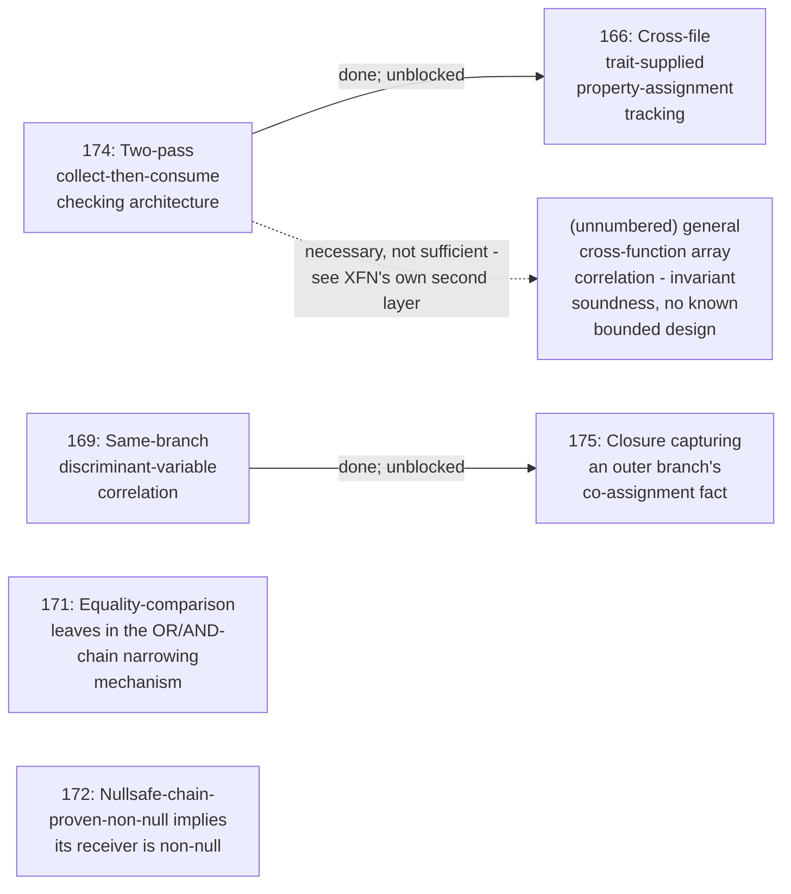

# Phase dependency graph

Reinstated after being retired (see git history: "Retire
PHASE_DEPENDENCIES.md - no live blocking edges left") once a session-long
reevaluation of ROADMAP.md's "Permanent design boundaries"/"Won't-port"
lists produced real new phases (PHASE_BACKLOG.md's Phases 158-175) with
live dependency edges among them - unlike the rest of the backlog, which
has no cross-phase blockers today.

Extracted directly from every "needs Phase N" / "blocked on Phase N" /
"prerequisite for Phase N" statement made while filing Phases 158-175 -
not inferred. Every other phase in PHASE_BACKLOG.md (1-157) has no
dependency edge at all and isn't repeated here.

Regenerate by re-grepping `PHASE_BACKLOG.md`/`ROADMAP.md` for
`Phase [0-9]\+` after any substantial edit to this range - this file
drifts the same way corpus counts do, and isn't re-derived automatically.

## Graph

Solid arrows are hard blockers stated directly in ROADMAP.md/PHASE_BACKLOG.md.
The dotted arrow is a "necessary but not sufficient" note, not a hard
block: Phase 174 alone doesn't finish general cross-function array
correlation, since a fact persisted across a function boundary still
needs a separate, currently-unsolved invariant-maintenance proof to be
sound against arbitrary intervening mutation - that second layer has no
phase number because it has no known bounded design yet (see ROADMAP.md's
own boundary entry for the full reasoning), unlike every other node here.

Phases 171 and 172 are listed for context (both reevaluated in the same
session, alongside 169) but have **no** dependency edge on 169 or on each
other - each is a self-contained new leaf/match-arm addition to an
already-existing, already-working mechanism (`or_chain_narrowing_target`/
`and_chain_narrowing_target` for 171, `apply_narrowing`'s own direct-arm
dispatch for 172), not built on top of 169's own new correlation
mechanism. Listed here only so a reader scanning this file doesn't assume
a missing edge was an oversight.

## Edge list (with source)

| From | To | Relationship | Status |
|---|---|---|---|
| **174** Two-pass checking architecture | **166** Cross-file trait-property tracking | preferred path (166's own option (a), an N-times-per-host re-check, was never needed) | **satisfied** - both built in the same session (`Project::collect_property_assign_facts`/`check_file_with_property_assign_facts`, `checker/property_type_too_wide.rs`), validated together (3285 tests passing) |
| **174** Two-pass checking architecture | General cross-function array correlation (unnumbered - see ROADMAP.md's own boundary entry) | necessary, not sufficient | live - 174 is built, but the invariant-soundness layer on top still has no known design; this edge alone doesn't close the gap (not a phase-to-phase block, since the target has no phase number) |
| **169** Same-branch discriminant-variable correlation | **175** Closure capturing an outer branch's co-assignment fact | hard blocker (Phase 175's own feasibility depended on 169's stored-fact shape being settled first) | **satisfied** - 169 is built (`Locals::branch_implied_facts`); Phase 175 is now independently assessable (its own PHASE_BACKLOG entry re-scoped accordingly) but still itself unimplemented - a separate, still-open backlog item, not a live dependency edge |

Every real phase-to-phase edge above is now satisfied. The one
remaining live note (174 -> general cross-function correlation) isn't
a block between two numbered backlog phases - it stays here as
context for whoever eventually picks up that unnumbered, unsolved
problem, rather than being deleted the way a fully-satisfied graph
would otherwise warrant retiring this file for.
