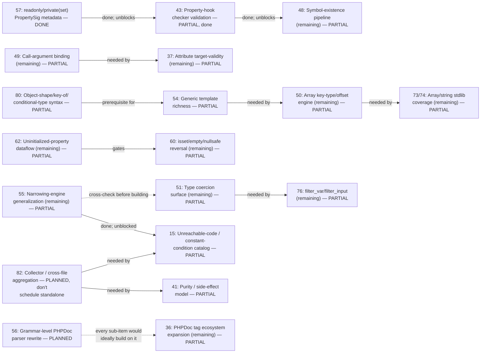

# Phase dependency graph

Extracted directly from every "needs Phase N" / "blocked on Phase N" /
"prerequisite for Phase N" / "cross-check against Phase N" statement in
`ROADMAP.md` (grep for `Phase [0-9]` and reviewed each hit in context - not
inferred). Most Pending phases have **no** dependency edge at all; only the
graph below and the "genuinely independent" list at the end are exhaustive.

Regenerate by re-grepping `ROADMAP.md` for `Phase [0-9]\+` after any
substantial edit - this file drifts the same way corpus counts do, and isn't
re-derived automatically.

## Graph

Solid arrows are hard blockers stated directly in ROADMAP.md ("needs",
"blocked on", "prerequisite for", "gates"). Dotted arrows are coordination
notes, not hard blocks (55↔51: don't reinvent range arithmetic twice; 56→36:
architectural nice-to-have, explicitly "not a hard blocker").

## Edge list (with source)

| From (satisfies) | To (blocked/helped) | Relationship | Status of the edge today |
|---|---|---|---|
| **57** readonly/private(set) `PropertySig` metadata | **43** Property-hook checker validation | prerequisite | 57 done → edge satisfied; 43 built the same session (picked as the first "unblocking" phase) |
| **43** Property-hook checker validation | **48**'s `ExistingClassesInPropertyHookTypehintsRule` | blocks | 43 done → edge satisfied for the existence-checking half (a `set` hook's own parameter type); 48's own entry now names the narrower remaining sub-checks (template-referenced-in-parameter, unresolvable native type, native union pre-8.0) directly, not as blocked on 43 |
| **49** Call-argument binding (remaining) | **37**'s attribute constructor-argument validation | needs | 49 PARTIAL, the needed generalization not yet done → still blocked |
| **54** Generic template richness | **50**'s reverted `InvalidKeyInArrayDimFetchRule` reattempt | blocks | 54 PARTIAL (the relevant rewrite not done) → still blocked |
| **80** Object-shape/key-of/conditional-type syntax | **54**'s `TemplateKeyOfType`/`TemplateObjectShapeType` bound kinds | prerequisite | 80 PARTIAL; the specific deferred-resolution piece 54 needs isn't done yet |
| **51** Type coercion surface (remaining) | **76**'s `options` array `default`/`min_range`/`max_range` | needs | 51's `IntegerRangeType` completion not finished → still blocked |
| **50** Array key-type/offset engine (remaining) | **73/74**'s `array_key_exists` narrowing | needs | 50's `HasOffsetType`/`HasOffsetValueType` accessory facts not built → still blocked |
| **62** Uninitialized-property dataflow (remaining) | **60**'s offset/property-chain `isset($x['key'])` half | gates | 62's real dataflow not built → still blocked |
| **82** Collector / cross-file aggregation | **41**'s transitive purity across the call graph | needs | 82 explicitly PLANNED, "don't schedule standalone" → still blocked |
| **82** Collector / cross-file aggregation | **15**'s `FunctionCallConstantConditionRule` cross-file dedup | needs | same → still blocked |
| **55** Narrowing-engine generalization | **15** (original constant-boolean-condition family) | was the prerequisite | 55's fixed-point loop convergence shipped → **edge satisfied, 15 reinstated in full** (see Done) |
| **55** Narrowing-engine generalization (comparison-outcome/range API) | **51** IntegerRangeType work | coordinate, don't duplicate | both still open; explicitly flagged so whichever is built first doesn't reinvent range arithmetic |
| **56** Grammar-level PHPDoc parser rewrite | **36** PHPDoc tag ecosystem (every sub-item) | soft/architectural | 56 PLANNED; not a hard blocker, sub-items of 36 proceed independently today |

Three edges above are already satisfied (57→43, 43→48, 55→15's original
family) - kept in the graph because they explain *why* 43, 48's existence-
check half, and 15 are buildable/built now, not because they're still
live blockers.

## Genuinely independent (no dependency edge either direction)

Everything else in Pending/partial: **18, 19, 36's other sub-items, 39, 40,
42, 45, 46** (needs a `pcre2` binding - an external crate, not a phase),
**52, 53, 61, 63, 64** (blocked on an internal `PropertySig::ty_native`
split, not another phase), **67, 68, 69, 70, 71, 73/74's other sub-items,
75, 77, 78, 83, 84**. These can be picked up in any order with respect to
each other - their Pending entries name *reasons* (low corpus incidence,
size, deliberate scope trims) but never another phase number as a blocker.
