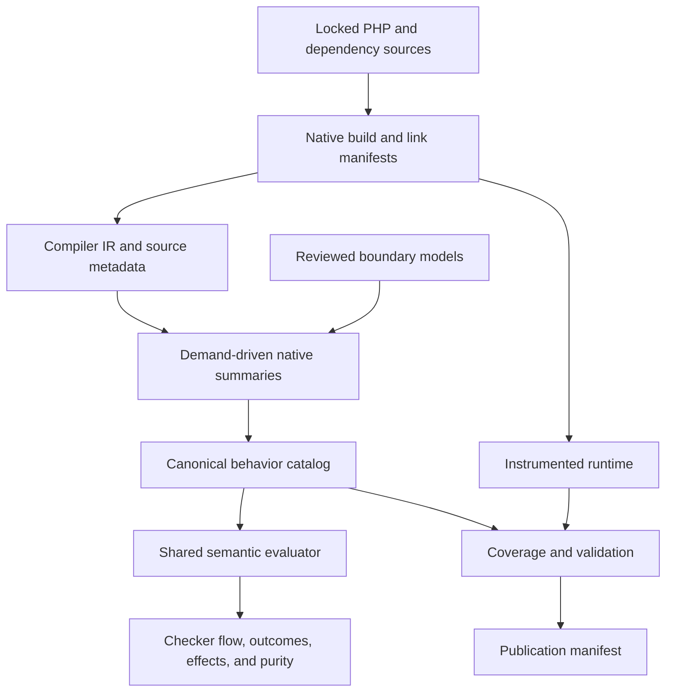

# Versioned PHP semantics catalog: complete implementation design

Status: DESIGN with measured native representation/framework experiments. The production feature and full Phase F gate remain unimplemented. See [the comparison decision record](PHP_SEMANTICS_CATALOG_COMPARISON.md).

The [extended evaluation](PHP_SEMANTICS_CATALOG_EVALUATION.md) is complete at the
compiler/framework campaign level. Stock and compact-layout SVF both hit the
enforced 10 GiB limit on the actual minimal CLI link. Layout adaptation alone
does not satisfy the reuse gate; copy/initializer misses and coverage-aware
native capsules need investigation before further full-profile retries. CIR
emission succeeded for only 44/523 C units. No Phase F task is DONE.

This replaces the earlier outline and the catalog architecture in `PROFILE_DRILL_PIWIGO_20G.md`. The optimization ledger's scheduling remains unchanged: implementation of the deferred catalog is a separate project after O3 unless the user changes that order. The task sequence in §15 is this feature's implementation order, not a continuation of the optimization ledger.

## 1. Goal, boundaries, and decisions

Generate a reproducible, source-backed description of what PHP functions, methods, and language operations can do. Use it as the common input to the checker's storage effects, implicit calls, argument coercion, return inference, exception flow, retention, and purity judgments.

Decisions already made:

- Full generator and checker integration, delivered in complete slices.
- Evidence-backed semantic models are permitted; their assumptions and applicability are explicit.
- PHP 7.0–8.5 is the version range. The first build is upstream PHP 8.5.4, independently of the host's installed PHP.
- Linux, Windows, and macOS coverage is expressed through verified profiles. A profile never stands for every build of its minor version.
- Maximum churn is permitted. Replace duplicate mechanisms and interfaces where the new model requires it; preservation of the prototype's architecture is not a requirement.
- The runtime checker needs no compiler, Docker, source checkout, solver, or native analysis library.
- LLVM plus Clang source/type/layout metadata is selected for the first Clang-built profile based on the measured comparison in §2.3. Production solver acceptance remains gated by Phase F. Prefer adapting SVF's pointer infrastructure before duplicating it; require compact layout storage and coverage-aware unknown boundaries. The shared observable contract and checker architecture do not depend on the pointer framework.

The target is a sound overapproximation within declared build and program assumptions, with useful precision on the acceptance cases. It is not a claim of exact behavior for every input or a formal verification of php-src. Undefined behavior in native code is outside the guarantees of compiler-based analysis; missing code, unknown PHP inputs, and unsupported defined operations are handled conservatively.

### Correctness contract

For each target scenario and declared assumption set, every possible concrete observable execution must be represented by the abstract execution: values/storage, event order, normal and exceptional exits, and finite prefixes of suspended or nonterminating execution. An absent behavior is a claim under those assumptions, not merely the absence of an event in a generated file. Termination is a separate property and requires separate justification.

Record assumptions as first-class IDs: build/linkage identity, loaded-program boundary, native defined-behavior assumptions, engine invariants, and reviewed contracts. Each conclusion references its required assumptions. Provenance explains where a conclusion came from; it does not certify that the transfer/model is correct. Validation checks structural obligations and contradictions without claiming formal verification of the entire toolchain.

Prioritize semantic correctness, useful precision, and maintainable boundaries, then measured resource efficiency. Maximum churn permits replacing checker infrastructure as well as the generator. It does not require preserving current APIs, serialized summaries, or recursive AST execution when those prevent a single correct flow model.

This project does not implement the separate plan for verifying every PHPDoc claim, change the project's assumptions about which PHP declarations are loaded, or rework the full source lexer. It does remove trust in builtin stubs and `@throws` wherever that trust would contradict catalog behavior. Unrepresentable dynamic names produce unknown dispatch rather than a false exact name.

### 1.1 Why the old architecture is replaced

The preserved PHP 8.4 prototype reached approximately 18.6 million nodes and 439 million edges before exceeding its 10,000 MiB limit. Compact sets were already present; copying imprecise byte regions multiplied the graph. The replacement does not materialize all native memory relationships before answering a PHP question.

It uses compiler-produced control flow, compact symbol and callback indexes, demand-driven regional memory analysis, and parameterized summaries. Unknown native memory is represented symbolically; it is not expanded into an edge to every known object. Memory and precision improvements remain acceptance requirements to demonstrate, not assumptions about the new design.

## 2. Components and dependency boundaries

| Component | Responsibility | Dependencies allowed |
|---|---|---|
| `crates/php-semantics` | Shared schema, validation, target predicates, graph and return-rule evaluation, canonical encoding | Existing workspace serde, sha2, postcard; no checker or compiler dependency |
| `tools/php-catalog` | Native analysis, model loading, store, coverage, explanations, artifact generation | Shared schema and existing Rust utilities; external importer and solver processes |
| `tools/php-catalog/native` | C++ Clang/LLVM companion: AST metadata, actual compiler IR, compact export, tracing instrumentation | Pinned LLVM/Clang C++ libraries; CMake |
| `tools/php-images` | Locked source acquisition, native build recipes, build and link capture, runtime exports | Host/container build tools; invoked explicitly |
| `crates/phpstan-rs/src/semantics` | Bridge to types, registry identities, locals, PHP dispatch, and diagnostics | Shared schema and existing checker/registry facilities |
| `xtask::catalog` | Pipeline commands, progress, validation orchestration, publication | Existing xtask infrastructure; invokes tools rather than linking LLVM |

`php-semantics` has no dependency on `syntax` or `types`: its names are byte strings, operands are symbolic values, and its evaluator uses a host trait. The checker provides that trait. This avoids a dependency cycle and lets native fixtures use the same artifact evaluator with a small reference host.

Within `phpstan-rs`, add `flow` for the PHP control-flow IR and lowering; `semantics` is its catalog/abstract-state bridge. NativeIR, PhpFlowIR, and BehaviorGraph are different representations with explicit translation contracts. NativeIR preserves compiled native behavior; PhpFlowIR preserves PHP control/data flow; BehaviorGraph is the parameterized observable contract. Sharing graph primitives must not erase language-specific storage, coercion, or lifetime rules.

Pin LLVM/Clang 21.1.8 and Z3 5.1.0 in an offline toolchain lock, including source or executable digests. Z3 is used through SMT-LIB over a child process, so no Rust FFI or exception to the workspace's `unsafe_code = deny` is needed. The C++ companion is built only by explicit catalog commands, never by the application's ordinary Cargo build. Use existing Rust dependencies initially; add a dependency only for a demonstrated capability absent from them.



### 2.1 Prototype migration

Retain its registration knowledge, build-option inventory, allocator and external-function tables as material to audit, and traces as historical failure evidence. Re-express models in the new model format; do not import their old conclusions as verified facts.

Replace the AST JSON reader, handwritten native lowering, merged `Program`, global `pta` graph, and xxhash store in the production tool. Git history preserves the old implementation. Keep neither a selectable old solver nor two authoritative builtin tables after migration. The old PHP 8.4 export is useful as a regression workload, not as proof about PHP 8.5.

### 2.2 Concrete migration map

| Current area | Change |
|---|---|
| `tools/php-images/cc-record`, build scripts | Capture actual compile and link inputs; separate profile/source/toolchain acquisition from offline build |
| `tools/php-catalog/src/main.rs` and native lowering/PTA/store modules | Replace with pipeline stages, NativeIR importer, demand solver, reviewed models, and SHA-256 objects |
| `crates/phpstan-rs/build.rs` and builtin data generation | Embed validated catalog data; remove migrated generated behavior tables; include data/model dependencies in source hashes |
| `checker/expr/builtin_calls.rs` | Migrate builtin-specific return inference into shared rules; leave only the generic checker adapter |
| `checker/expr.rs`, `checker/call_effects.rs` | Execute ordered behavior once through evaluation plans; remove independent post-expression effects |
| `checker/throws.rs` and try/catch handling | Use explicit throw states and exit continuations; remove annotation-derived no-throw facts |
| `registry/effects.rs`, `summaries.rs`, `retention.rs`, `purity.rs` | Share body graphs and derive domain projections rather than separately infer behavior |
| `types` release representation, registry settings, `project/session.rs` | Preserve patch/range/Composer information and introduce explicit native targets |
| `project/file_cache.rs`, application/LSP configuration, `xtask` | Version semantic products, invalidate dependencies, orchestrate offline generation and validation |

Migration is allowed to change internal APIs and serialized products. Old cache formats get a version bump and rebuild; preserving stale caches is not a compatibility requirement. Existing public configuration forms keep their meaning, with documented richer version/target forms.

### 2.3 Alternatives and selection obligations

The earlier choice of LLVM was an architectural judgment. The [October 8 measured comparison](PHP_SEMANTICS_CATALOG_COMPARISON.md) now supports LLVM plus source metadata for the initial Clang profile: configured Clang CFG misses exceptional C++ destruction, while LLVM preserves it on both tested ABIs. The comparison includes real PHP imports and SVF pointer prerequisites, but does not certify closed PHP summaries or complete Phase F. §§6–7 specify the semantic engine; final pointer-framework acceptance must satisfy the remaining semantic/resource obligations before expanding the pipeline.

Separate four decisions: compiler/source representation, abstract memory/value domain, interprocedural solver/framework, and observable catalog schema. LLVM is a representation; SVF is a framework operating on LLVM. Replacing one does not automatically replace the other. Zend boundary contracts and the checker-facing graph are required whichever native representation wins.

#### 2.3.1 Representations

| Candidate | Potential advantage for this project | Main concern | Assessment |
|---|---|---|---|
| LLVM IR with Clang metadata | Explicit lowered control/data flow, SSA, ABI operations, and one representation for native dependencies | Lost source semantics, opaque pointers, and a project-specific semantic bridge | Selected initial producer; measured imports/cleanup pass, semantic closure still OPEN |
| Clang AST plus compiler-provided CFG | Retains declarations, fields, source types, and source-operation identities | Tested exceptional edge skips destruction despite enabled CFG options | Retain metadata; cannot be execution authority without repairing and validating cleanup lowering |
| ClangIR/CIR through MLIR | Intermediate abstraction between source AST and low-level LLVM; potential to retain richer semantics while lowering | Required language/ABI/exception features and API availability must be established in a pinned version | Capability audit first; no production dependence on an unverified development feature |
| GCC GIMPLE | Captures the actual GCC frontend/configuration for GCC-built PHP; lowered control flow without changing compiler family | Adds GCC-specific importer/plugin maintenance and does not cover other compilers by itself | Serious compiler-specific producer option; compare if GCC coverage cannot be justified through the selected producer/contracts |
| Binary lifting/decompilation | Can inspect an actual distributed binary or an unavailable-source dependency | Recovering high-level value/layout/callback meaning adds difficult uncertainty | Optional missing-source capability; not the initial complete generator |

Clang CFG is distinct from the prototype's handwritten AST lowering. Its pinned API provides explicit options for exception edges, implicit/temporary destructors, initializers, and lifetime-related nodes. Those options require configuration and semantic validation, rather than assuming default CFG construction is complete: [LLVM 21.1.8 CFG API](https://github.com/llvm/llvm-project/blob/llvmorg-21.1.8/clang/include/clang/Analysis/CFG.h).

GIMPLE supplies a lowered C/C++ representation with explicit control flow: [GCC GIMPLE documentation](https://gcc.gnu.org/onlinedocs/gccint/GIMPLE.html). CIR's documented ABI design still describes ongoing work, so current upstream documentation is not proof that the pinned compiler can import every required profile: [ClangIR ABI design](https://clang.llvm.org/docs/CIR/ABILowering.html).

#### 2.3.2 Analysis engines and complementary approaches

| Candidate | What can be reused | What still needs project-specific work |
|---|---|---|
| Clang dataflow / Static Analyzer components | Compiler CFG, symbolic values, regional store concepts, transfer infrastructure | Pinned FlowSensitive API rejects native C; diagnostic analyzer needs summary extraction and explicit cutoff coverage |
| SVF, including demand-driven analysis | Measured pointer/value-flow queries, call-graph support, memory SSA, and existing solvers | Eager array-layout expansion, coverage-aware external writes, conditional Zend semantics, and ordered summary production |
| Custom demand-driven regional analyzer | Direct control over symbolic Zend templates, summary shape, and conservative unknowns | Largest new correctness/maintenance burden; every native transfer and fixed-point mechanism needs validation |
| CBMC or symbolic-execution tools | Reduced-case contract checking, counterexamples, and concrete path witnesses | Bounded/explored paths cannot by themselves supply complete unbounded catalog coverage |
| Declarative models plus runtime tracing | Useful reference contracts and positive event/dispatch witnesses | Ongoing review burden and missing automated source-derived facts; traces cannot justify negative claims |

Clang exposes regional memory and dataflow facilities, but using its diagnostic engine unchanged does not establish complete catalog coverage. Review loop/inlining/devirtualization fallbacks against our unknown-transfer rules: [Clang dataflow](https://clang.llvm.org/docs/DataFlowAnalysisIntro.html), [Region Store](https://clang.llvm.org/docs/analyzer/developer-docs/RegionStore.html), [interprocedural analysis](https://clang.llvm.org/docs/analyzer/developer-docs/IPA.html).

SVF explicitly offers demand-driven analysis and memory SSA, so it must not be rejected merely as a global solver: [SVF capabilities](https://github.com/SVF-tools/SVF). Measure initialization and graph construction as well as query solving; its flow-sensitive DDA implementation has an Andersen-based fallback, which needs its own coverage/precision dependency record: [SVF FlowDDA source](https://github.com/SVF-tools/SVF/blob/master/svf/lib/DDA/FlowDDA.cpp). Pin the evaluated revision before drawing conclusions.

CBMC can check reduced contracts by loop unwinding and assertions; completeness of the bounds/assumptions is a separate obligation: [CBMC documentation](https://www.cprover.org/cbmc/). It is a validation option rather than a replacement for recursive summary generation. Current Clang summary-extraction infrastructure is also a reuse candidate, but its documentation describes a rapidly evolving framework; verify pinned-version availability first: [Clang summary extraction](https://clang.llvm.org/docs/ScalableStaticAnalysis/user-docs/SummaryExtraction.html).

#### 2.3.3 How alternatives are weighted

Correctness under explicit assumptions and conservative treatment of incomplete work are hard constraints. The required resource envelope and usable precision sentinels are also pass/fail gates. A fast result that omits behavior cannot compensate for those failures.

Among candidates meeting those gates, use this qualitative priority order:

1. Useful parameterized closure: callback targets/arguments/results, aliasing, writes, exception/cleanup order, and negative facts with valid assumptions.
2. Coverage of the required C/C++ constructs, builds, library boundaries, and platforms.
3. Maintainable semantic transfers, source traceability, reuse of proven infrastructure, and a manageable trusted computing base.
4. Incremental summaries, bounded growth, reproducibility, and measured runtime/peak memory below the cap.
5. Implementation effort and migration convenience. Maximum churn makes preservation of existing code a low-priority factor.

These are decision priorities, not benchmark scores. No numerical winner or speed/memory improvement is claimed without measurements. Framework maturity does not prove that its configured abstraction is sound or sufficiently precise for Zend.

#### 2.3.4 Focused comparison protocol

Compare the LLVM/region candidate and Clang AST/CFG candidate on the same locked 8.5.4 slice and observable contract. Assess SVF/framework reuse on the pointer/dispatch/summary prerequisites of that slice before implementing equivalent mechanisms from scratch. Use the same boundary contracts where applicable and distinguish unavoidable contracts from contracts compensating for lost representation precision.

Include direct/scalar behavior, conditional array callbacks, by-reference mutation, pending-exception cleanup, object-handler dispatch, retained callbacks, and the reduced byte-copy/unknown-pointer failures. Include a small C++ cleanup fixture and representative older PHP/platform compiler constructs to avoid choosing solely for one easy C wrapper.

Record end-to-end peak memory/time, preprocessing/import/index cost, graph/region counts, unknown reasons, closed semantic facts, contract volume, adaptation complexity, and invalidation behavior. Include unsuccessful imports and required compiler changes. Default cutoff behavior is audited; a truncated exploration never becomes absence.

Prefer reusable infrastructure when it meets the same semantics/resource obligations. Choose the custom kernel only with a documented gap and reduced evidence showing why reuse fails or would create greater semantic complexity. A mixed source-metadata/low-level producer is acceptable when the roles and transfer boundaries are explicit; do not maintain two competing effect authorities.

Phase F ends with a decision record and updated implementation details. The comparison adapters are bounded experiments; completion ships one selected authoritative producer/solver arrangement. The native models, behavior schema, and checker flow design survive that selection.

Measured findings and implementation consequences:

- Six PHP 8.5.4 translation units import through LLVM, AST/CFG, and GIMPLE; selected runtime traces agree between actual TAILCALL and explicitly configured CALL builds. These are import/witness results, not closed catalog graphs.
- SVF DDA completes selected PHP array/invocation translation-unit tests below 210 MiB, but initializes Andersen/value-flow graphs before solving demands. Low budgets fall back to Andersen and must retain that dependency/precision reason. On the full actual minimal CLI link, both stock and compact-layout variants are killed at the enforced 10 GiB limit.
- An unmodeled external write yields an incorrect exhaustive callback target if consumed without a coverage gate. Supplying the external body repairs the result; the blackhole option alone does not. Unknown bodies/models must widen and havoc affected domains before any exclusion is accepted.
- A 64 MiB static byte buffer produces a constant pointer graph but about 2 GiB RSS in stock SVF because type/layout tables expand per element. Compact layouts address this isolated cost, but both layouts fail the full-link resource gate and both tested modes miss targets in nested/copy fixtures. Continue only with reduced, discriminating SVF experiments before considering any production assistance.
- SVF is a bounded reuse candidate, not the preferred production helper: it must first pass a reduced resource/coverage gate. Any pointer service remains subordinate to the regional ordered semantic engine and cannot independently certify PHP effects/returns/throws. Compare an audited configuration against the regional candidate on closed PHP summaries before final production solver selection.
- Phase F remains OPEN: no checker-backed BehaviorGraph, native/PHP semantic closure, complete profile, or kernel aggregate-memory acceptance has been established by these probes.

## 3. Reproducible builds and coverage profiles

### 3.1 Locked inputs

Maintain `sources.lock.json`, `toolchain.lock.json`, and profile TOML files under the catalog tool. Lock entries identify source URL, SHA-256, version, patch set, license metadata, generated-source recipe, dependency versions, and build recipe digest. Sources are obtained only by an explicit fetch command. Build and analysis commands can run with networking disabled after acquisition.

Use upstream release tarballs with checked digests, not the floating source inside `php:8.5-cli`. The first exact release is 8.5.4. Updating a source or dependency is a reviewed lockfile change. Snapshot the official release inventory for 7.0–8.5; new releases require an explicit update and regeneration.

Each build manifest records:

- PHP patch release, distribution patches, target triple, integer/pointer widths, endianness, libc, compiler and flags.
- SAPI, NTS/ZTS, debug/release, extension binaries and versions, link order, exported symbols, dynamic dependencies, and default ini values.
- Every compilation and link command as argument arrays, response-file contents, working directories, environment inputs, and generated sources.
- Source/header dependency digests, actual configure output, installed runtime files, and tool versions.

Semantic flags cannot be silently dropped. Diagnostic/output-path flags may be normalized. Any other unsupported flag makes that unit unavailable for analysis or requires a reviewed translation recorded in the manifest.

### 3.2 Build layout and VM generation

Use compatible configure groups rather than forcing all SAPIs into one configure invocation. Core CLI/phpdbg/FPM, Apache, embed, and other available SAPIs produce distinct link manifests. An extension that cannot build is an explicit exclusion with a reason.

Generate CALL VM handlers for analysis and construct mapping. Also build the profile's normal execution VM. Treat the generated representation as an analysis transform whose behavior must be checked against the normal VM; do not label the normal build covered merely because CALL mode parsed successfully.

Build an instrumented runtime from the same locked source and configuration. Keep native binaries and logs under `.corpus-runs/catalog/<run-id>/`, and reusable inputs under `~/.cache/phpstan-rs/catalog/`. Nothing needed by a later gate lives only in `target/` or `/tmp`.

### 3.3 Exact linkage and compiler coverage

Each executable/shared object has a `LinkUnitId`; local symbols are identified by their defining object. Model ELF, PE/COFF, and Mach-O linkage for the platform being published. Name resolution follows the manifest's visibility, weak definitions, load order, and interposition assumptions. A different or unknown load order is a different case, not another duplicate definition silently merged into the same symbol.

A Clang-built profile covers its actual compiled configuration. The importer must not pretend that GCC predefined macros and Clang code generation are interchangeable. A GCC/MSVC or distribution build is covered only through a separately recorded profile and validated source/configuration equivalence or applicable models. Unsupported compiler-specific code stays explicitly unknown.

An equivalence record must identify the compared preprocessed semantic regions, ABI/layout assumptions, differing compiler branches, applicable external contracts, and unchanged dependencies. Matching versions, macro names, or traces alone are insufficient. If such a record cannot establish coverage, publish compiler-conditioned cases and an open remainder. Do not spoof predefined macros to manufacture matching import results.

### 3.4 Required publication matrix

First publish the exact 8.5.4 Linux x86-64 glibc NTS CLI profile. Then add:

- Linux baseline profiles for every minor 7.0, 7.1, 7.2, 7.3, 7.4, 8.0, 8.1, 8.2, 8.3, and 8.4, initially its latest stable patch in the locked inventory.
- All stable patch releases in the inventory for the Linux baseline, using compile-input and summary reuse; failures remain explicit coverage gaps. Completion of the feature requires at least one verified baseline for each minor, not a claim that every patch or library combination is verified.
- PHP 8.5.4 Linux ZTS, debug, aarch64, and musl profiles; their facts remain conditional on profile properties.
- Native Windows x86-64 NTS and macOS arm64 PHP 8.5.4 profiles using native build jobs and real SDK/configuration outputs. Unsupported older combinations remain gaps.
- Additional compatible SAPIs, all buildable bundled extensions, and pinned PECL releases represented by the embedded stub inventory. Proprietary or unavailable extensions get entries with unknown behavior.

32-bit, big-endian, other distributions, and additional library versions are supported by the profile machinery and conservative fallback, without being silently equated to a baseline. No fact is generalized across builds merely because the observed outputs match. Generalization requires a source/configuration dependency argument or a model whose applicability covers those builds.

## 4. Shared catalog schema and evidence

### 4.1 Stable identities

Use SHA-256 identities for artifacts and semantic records. Runtime arrays use dense `u32` indices assigned after canonical sorting; persistent references use content IDs or stable keys. Every schema has an explicit major version; changing interpretation requires a major-version change and regeneration.

Core record types:

```rust
struct CatalogManifest {
    schema_major: u32,
    generator: Digest,
    profiles: Vec<ProfileRef>,
    entries: Vec<EntryRef>,
    models: Vec<ModelRef>,
    validation: ValidationRef,
}

enum EntryKey {
    Function { extension: Bytes, name: Bytes },
    Method { extension: Bytes, class: Bytes, name: Bytes },
    Opcode { number: u32, specialization: OperandKinds },
    Construct { kind: ConstructKind, context: AccessContext },
}

struct BehaviorEntry {
    key: EntryKey,
    applicability: PredicateId,
    parameters: ParameterLayout,
    graph: GraphId,
    domains: Vec<DomainCoverage>,
    evidence: Vec<EvidenceId>,
}
```

Builtin symbol matching folds ASCII only. Data strings, URLs, diagnostic words, dynamic member names, and paths preserve bytes. Artifact JSON represents non-UTF-8 bytes with an explicit base64 object; it never replaces them with Unicode replacement characters.

### 4.2 Observable domains

Coverage and unknowns are tracked independently for: user-code invocation, user-storage reads, user-storage writes, external reads, external writes, diagnostics, class lookup/autoload, output, releases/destruction, retention, normal return, PHP throws, fatal exits, and suspension/resumption. Allocation/identity and termination properties support those domains.

`DomainCoverage` carries both derivation coverage and precision:

- `Closed`: every relevant reachable operation was interpreted or covered by an applicable reviewed contract. This can still overapproximate inputs or loops.
- `Open { reasons }`: missing code, unsupported instructions, unresolved dispatch, or uncovered target conditions may add behavior. Add an unknown transfer in the affected domains.
- `NotApplicable`: the domain is excluded by an explicit entry kind or impossible applicability condition, with evidence.

`Exact`, `Joined`, and `Widened` describe precision separately. Closed coverage does not mean exact output or formally proven source correctness. A recorded run is evidence of possible behavior, never evidence for a negative fact.

Coverage is indexed by applicability case and domain, not just by entry. Keep coverage separate from assumptions and precision: a source-closed transfer and a contract-closed transfer can have different trust dependencies. Joining cases unions required possibilities and computes closure only over the entire selected target set. One closed profile cannot close an uncovered remainder.

Distinguish closure of a parameterized catalog contract from closure of an instantiated checker query. A source-closed contract can invoke an argument whose PHP target/body is unknown. The host propagates that child's open domains, precision, and assumptions into the result. An absence of direct `Write`/`PhpThrow` nodes does not prove absence through `Invoke`, destruction, handlers, or autoload. Negative projections require closure of the composed execution, not merely the entry record.

A missing entry differs from a registered entry returning `null`, an entry with no normal return, and a closed entry doing nothing. These distinctions are represented as different variants, not empty vectors sharing one meaning.

### 4.3 Evidence and explanations

`Evidence` variants are `SourceTransfer`, `ModelContract`, `DispatchResolution`, `Invariant`, `Widening`, `UnknownBoundary`, and `Observation`. Each records source/package digest, source span or IR site, rule/model version, input assumptions, and dependencies.

Facts that remove behavior must depend on source analysis, a reviewed contract, or a checked invariant. Observations may add possibilities and detect contradictions but cannot justify purity, non-retention, no-throw, or an unreachable branch.

Store detailed evidence in the offline manifest. Runtime artifacts include compact evidence IDs and their explanation index; loading and normal checking do not format explanation text.

## 5. Behavior graphs and public query interface

### 5.1 Graph structure

A graph has parameters, typed symbolic values, basic blocks, ordered events, and control-flow terminators. Graphs may share subgraphs and have explicit loop edges. The serialized graph is finite even when execution repeats indefinitely.

Events are:

- `Read`, `Write`, `BindReference`, and `Allocate` over symbolic storage.
- `Invoke` for a callable, method, object handler, registered handler, or retained callback; produces a result token and possible exceptional outcomes.
- `Retain`, `ReplaceRetained`, `ReleaseRetained`, and `ReleaseValue`.
- `Diagnostic`, `ClassLookup`, `Output`, and `ExternalAccess`.
- `SetRuntimeSetting`, `Suspend`, `Resume`, and `Unknown` with domain masks and reasons.

Terminators are `Branch`, `Join`, `NormalReturn`, `PhpThrow`, `NativeUnwind`, `Bailout`, `FatalExit`, and `SuspendExit`. Native exceptions are not automatically PHP `Throwable`s; source/model transfers establish their translation or uncaught process exit.

Storage roots distinguish arguments, argument referents, receiver, callback result, local allocations, globals/superglobals, caller frame, class/static storage, engine registrations, retained handle state, and external domains. Paths distinguish named fields, constant array keys, wildcard elements, references, and reachable content. Unknown reference targets widen their own storage domain.

### 5.2 Conditions and symbolic results

Predicates describe operand tags, class/interface membership, literal/interval comparisons, integer bits, string properties, typing mode, known URL schemes, setting values, release/version/profile properties, and presence/identity facts. Tests depend on immutable value or state-version tokens. A callback or write can invalidate a state-dependent predicate before a later read; entry arguments are not assumed unchanged forever.

Return expressions support literals, argument/receiver identity, native tag bounds, integer intervals and overflow, unions, conditionals, array keys/values/shapes/listness, element mapping/filtering, callback results, and verified intrinsic transformations. Intrinsics are named operations with shared evaluators and model contracts, not arbitrary code embedded in data. No PHP, C, or downloaded source is executed to infer a user's return type.

### 5.3 Shared API

```rust
trait SemanticHost {
    type Value;
    type State;
    fn test(&self, p: ResolvedPredicate<'_, Self::Value>,
        state: &Self::State) -> Truth;
    fn apply(&mut self, event: ResolvedEvent<'_, Self::Value>,
        state: Self::State) -> EventOutcomes<Self::Value, Self::State>;
    fn intrinsic(&self, op: &Intrinsic, args: &[Self::Value],
        state: &Self::State) -> Self::Value;
    fn join_value(&self, a: Self::Value, b: Self::Value) -> Self::Value;
    fn join_state(&self, a: Self::State, b: Self::State) -> Self::State;
    fn widen_value(&self, old: Self::Value, next: Self::Value) -> Self::Value;
    fn widen_state(&self, old: Self::State, next: Self::State) -> Self::State;
    fn value_subsumes(&self, broad: &Self::Value, narrow: &Self::Value) -> bool;
    fn state_subsumes(&self, broad: &Self::State, narrow: &Self::State) -> bool;
}

impl Catalog {
    fn select(&self, key: &EntryKey, target: &TargetSet) -> Selection;
    fn evaluate<H: SemanticHost>(&self, selection: &Selection,
        invocation: Invocation<H::Value, H::State>,
        host: &mut H) -> Evaluation<H::Value, H::State>;
    fn project(&self, selection: &Selection, domain: Domain) -> Projection;
    fn explain(&self, evidence: EvidenceId) -> ExplanationRef;
}
```

`Truth` is Yes/No/Maybe. Maybe forks and joins; it never chooses one branch. `Evaluation` keeps normal, PHP exceptional, fatal, and suspended states separate. Projection is an overapproximation of the graph for consumers that only need a domain; it cannot certify absence in an open domain.

The signatures describe the shared interface; concrete visibility/lifetimes follow the crate implementation. The evaluator owns a frame containing host state and symbolic value bindings. It resolves graph operands into `ResolvedPredicate`/`ResolvedEvent` values before calling the host. `EventOutcomes` carries result-token bindings and separate normal/exceptional/fatal/suspended states, so a callback's result and mutations feed later graph operations. Joining/widening frames applies the value and state operations above; subsumption determines worklist convergence. Intrinsic evaluators cannot mutate state or invoke user code.

Host outcomes also carry per-domain coverage/precision and required assumption IDs. Evaluation composes these with catalog evidence and retains unresolved child boundaries. These properties are part of the returned semantic result and its cache key/dependencies, not optional diagnostic metadata.

Loops use a worklist and host widening. Repeated diagnostics are deduplicated by the PHP operation site, catalog event, and predicate case; user input can select several distinct warning cases. Runtime graph expansion is bounded through sharing and widening rather than a fixed execution count that drops later effects.

### 5.4 Unknown transfer is an operation

Unknown is not just a report label. Its domain mask drives actual evaluation:

| Open domain | Required conservative transfer |
|---|---|
| Invocation | Admit arbitrary applicable user-code entry and its outcomes; invalidate state assumptions that it may change |
| User reads/writes | Add broad observer dependencies; widen possibly reachable storage and aliases, including caller-frame access if not excluded |
| Retention/release | Keep possible owners/captures alive, widen affected slots, and admit destruction at applicable triggers |
| Return | Add a general value on possible normal outcomes; narrow only by independently trusted runtime-enforced bounds |
| PHP throw | Add possible `Throwable` and state at the unknown event; do not infer exception types from an absent annotation |
| Diagnostics/output/external access | Admit the event and applicable handler/wrapper invocation, with state and exit consequences |
| Autoload | Admit registered or unknown loaders and possible declaration/state changes |
| Fatal/suspension | Add distinct exit/suspended outcomes and retained continuation state |

An unknown native call can affect all domains; restrict its mask only with evidence of separation. A storage-only unknown cannot accidentally imply unknown return, and a known return cannot certify no callbacks. An unknown effect summary describes arbitrary repetitions with join/widening, not one guaranteed invocation. Termination uncertainty independently prevents `Droppable`.

Transient unfinished results are not unknown contracts. The schema distinguishes a completed conservative graph from an incomplete query, and publication rejects the latter.

### 5.5 Composition and projection rules

Sequential graph composition substitutes parameter/result/storage bindings and links normal continuations; exceptional/fatal/suspended continuations bypass later normal-only events. Alternative composition retains guards and unions outcomes. Meet/refinement is permitted only for independently valid constraints on the same state/outcome under compatible assumptions.

Domain queries compute dependency closure. A return query can require callback invocation, coercion, storage writes, throws, and mutable-setting reads; an invocation query can require argument values and registration state. Slicing retains those prerequisites and records why an operation is irrelevant before omitting it. Domain masks restrict reported properties, not the operations needed to derive them soundly.

A projection used only for display may discard detail conservatively. An executable projection must preserve dependencies and ordering, or explicitly widen them. Do not combine unrelated return/effect projections as if their branch alternatives were correlated. The full checker executes a shared graph once and reads all domain results from that execution.

## 6. Compiler import and native representation

### 6.1 Import real compiled control flow

The C++ companion pairs Clang AST metadata collection with LLVM code generation. AST metadata supplies declarations, source types, field layouts, registrations, annotations, and source locations; actual LLVM IR supplies executable control flow. Do not reconstruct execution from AST JSON. Keep both original bitcode and the imported representation as durable artifacts.

The export is a versioned stream of translation-unit, type, symbol, function, block, instruction, and source-map records. JSONL is the inspection/interchange format; the Rust importer validates it and stores canonical postcard objects. Records use explicit IDs and forward references. Streaming import avoids loading a complete compiler AST into Rust.

LLVM opaque pointers do not provide pointee types. Preserve Clang layout/type metadata and instruction-specific load/store/GEP types as hints. Missing metadata broadens possibilities; a guessed source type cannot exclude a possible indirect call. Debug metadata supplements the source map but is never the only record of executable operations.

Normalize with a pinned, small pass sequence: promotion of eligible local allocas, CFG simplification, and explicit constant folding with preserved origin maps. Preserve the original instructions and mappings to normalized instructions. Compare import coverage for unoptimized and production-optimized builds; optimization must not make unsupported behavior disappear from the coverage report.

The measured producer choice makes LLVM's explicit exceptional cleanup authoritative. Clang CFG elements may help source mapping, but their tested unwind gap must not omit a NativeIR operation. Resolve the actual VM kind from compiler capabilities and generated headers; in 8.5.4, requesting CALL generation alone can still select TAILCALL. Lock configuration and generated identities and validate the variant actually built.

### 6.2 Required native operations

`NativeIR` represents SSA values, phi/select, width-specific integer arithmetic, signed/unsigned comparisons, floating operations, casts, address calculation, loads/stores, aggregate operations, direct/indirect calls, varargs, atomics, fences, inline assembly, and LLVM intrinsics. It also represents invoke/unwind edges, landing pads, Windows exception funclets, and cleanup operations.

Give `undef`, poison, and freeze explicit abstract semantics. Model defined behavior permitted by these values conservatively. Native undefined behavior is recorded as a separate assumption/boundary; it does not become a PHP exception or justify an empty PHP effect set.

Unknown instructions create `UnknownBoundary` transfers covering every observable domain they might affect. Corrupt IR, inconsistent IDs, impossible layouts, or missing referenced records are importer errors. They cannot be converted into successfully imported empty functions.

Symbols are keyed by link unit, defining object, linkage identity, and source identity. Resolution uses the build manifest from §3. Resolve static initializers, startup/shutdown lists, extension registrations, and runtime symbol tables before entry discovery. Function aliases and generated handlers retain links to their real implementation rather than receiving unrelated summaries.

### 6.3 Entry and construct discovery

Discover functions/methods from registration tables and runtime reflection, including aliases, conditional registrations, parameter names/defaults, by-reference modes, variadics, visibility, and handlers. Reconcile both inventories: an observed registration missing from analysis fails validation; a source registration absent at runtime requires an explained condition.

Discover opcode specializations from generated VM tables. Map PHP constructs and operand contexts to opcode families through compiler output from small PHP fixtures. This mapping includes read/write/isset/unset/reference contexts rather than just expression names. Generated-handler source digests are dependencies of the mapping.

### 6.4 Explicit Zend/PHP abstraction bridge

Translate PHP arguments/receiver/state into symbolic native templates for zvals, strings, arrays, objects, resources, call frames, class/function metadata, and handler tables. Templates describe tags, contents, layouts, identities, aliases, and semantic hooks under the exact profile; they do not allocate one concrete native object per possible PHP class or value.

Specify both bridge directions. Native loads/tests map to symbolic PHP value/storage predicates; native changes project back to PHP writes, reference bindings, identity/lifetime changes, and outcomes. User-code invocation suspends the native transfer at an explicit continuation, supplies PHP operand bindings and invocation context, and resumes with separate normal/exceptional/fatal/suspended possibilities. Callback writes can invalidate native reads of the same aliased storage.

Provide contracts for engine data structures and high-level access helpers where raw field analysis loses semantic meaning. Structural contracts depend on actual layout/generated-source digests; semantic contracts depend on their reviewed source regions. Tag unions and class/handler conditions remain correlated. An unsupported mapping creates unknown effects, not an unmodified PHP argument.

Engine exception state is explicit. A PHP callback throw can return control to native code with a pending `EG(exception)`; native return status, return zval, pending exception, and storage state are separate components. The bridge resumes the source/model's exceptional continuation, including native cleanup and any permitted further effects, before exposing the propagated PHP throw. Setting, clearing, replacing, and rethrowing an exception follow source operations. Do not map every callback throw directly to an immediate terminal edge that skips cleanup. In PHP 8.5.4, `zend_call_function` has paths returning `SUCCESS` with an exception pending: [locked Zend invocation source](https://github.com/php/php-src/blob/php-8.5.4/Zend/zend_execute_API.c).

The bridge is a first-slice requirement and its own test surface. Round-trip fixtures cover scalar tags/widths, string bytes, referenced array elements, object identity/handler selection, callback-result types, by-reference writes, destruction, and throw continuations. Native memory closure alone cannot establish PHP semantic closure if the projection is incomplete.

## 7. Demand-driven native analysis

### 7.1 Query shape and state

The query key is `(entry or native function, domain demand, abstract argument shape, profile, analysis configuration)`. Start from PHP-visible entry roots and their reachable initialization state. Build a compact direct-call and candidate indirect-call index, then refine only the regions needed by the query. Do not compute whole-program points-to closure as a prerequisite.

`NativeState` contains SSA abstract values, a persistent regional memory map, path guards, event-graph state, exceptional continuations, and retained/asynchronous registrations. Summaries describe transfers over symbolic parameter regions. Instantiation substitutes caller regions and alias conditions; it does not copy every callee object into a global graph.

Abstract values include bottom, constants/finite sets, integer intervals and known bits, floating classes, PHP tags, aggregates, pointers, code pointers, and top. A pointer consists of a region, symbolic field/index path, offset interval, and provenance. A code-pointer set explicitly says whether its candidate set is closed. An open empty set means unresolved dispatch, never no dispatch.

Prefer a compact SVF-assisted pointer service before implementing equivalent global pointer machinery. Its inputs are audited native capsules: dependency closure under explicit boundary contracts, not translation units arbitrarily cut out of a program. Missing bodies, external/PHP inputs, escaping state, and unsupported operations keep affected results open and cause regional havoc. The semantic engine remains the sole observable authority. Accept a finite target exclusion only with applicable closure/model evidence; neither a successful helper process nor an empty points-to set supplies that evidence. Track Andersen initialization and budget fallbacks as part of query cost/dependencies. Adapted reuse must satisfy Phase F before becoming a production dependency.

### 7.2 Regional memory

Regions distinguish stack, heap allocation site, argument referent, global, thread-local, engine state, external storage, and unknown native storage. Layout paths use fields, constant/interval indices, and wildcard projections. Recursive structures use graph cycles rather than endlessly extending paths.

Store array layouts as element type, count, stride, and symbolic index/interval descriptors. A large fixed byte array must not allocate one metadata record per physical element. This applies to importer and helper type tables as well as the region graph: the measured stock SVF graph stayed constant while eager type flattening reached about 2 GiB for a 64 MiB buffer. A sparse helper-layout adaptation is a required reuse experiment; merely disabling array-sensitive pointer modeling did not avoid that cost.

Keep disjoint constant array elements when they affect PHP behavior. After the configured finite-index limit, join remaining elements into a wildcard region while retaining dependencies and coverage. Model overlapping `memcpy`/`memmove` as lazy segment transfers, with the correct overlap contract. Model `realloc` as identity/copy/failure alternatives. Neither operation creates byte-by-byte Cartesian edges.

Recover exact bytes only for a demanded fact, such as a registration name or a constant callback field. Unsupported provenance conversion yields unknown pointer content. Unknown native storage is a symbolic top region whose reads/writes and dispatch consequences are propagated on demand; it is not connected to every known allocation.

Top is not a disjoint fresh allocation. A store through an unknown pointer records a wildcard havoc over every potentially aliased region, using scoped invalidation tokens/default bindings rather than explicit edges. A later read of known storage must account for that havoc; it cannot return an old precise value merely because no edge was materialized. Dispatch, lifetime, and registration queries consume the same invalidation dependencies. Restrict the havoc scope only with an applicable alias/provenance argument.

Lazy copy descriptors reference source snapshots and ranges; overlapping copies use the appropriate source-before-write view. Normalize/fold descriptors at joins and loop sites so deferred copies cannot become an unbounded chain. Memory-definition/PHI identities are stable per IR site; cache revisions are not ever-growing semantic facts that defeat subsumption. When exact copy content cannot be preserved, join affected contents soundly and retain possible pointer/callback values.

A strong update requires a proven singleton target and exclusive relevant ownership at that point. Different argument positions do not prove non-aliasing. Summaries retain alias preconditions, and a possibly aliased call forks or joins the applicable transfer. Reentrant callbacks and asynchronous access invalidate uniqueness/state assumptions unless an applicable contract preserves them.

### 7.3 Dispatch resolution

Resolve indirect calls from initializer contents, stores/loads, argument propagation, allocation layouts, registration tables, and verified engine dispatch contracts. Use source and ABI types to refine candidates only when the exclusion rule is valid for that call, including casts and varargs. A heuristic signature match is not a closed target set.

At an unresolved site, retain known candidates and an unknown-call alternative. That alternative includes user-code entry, storage changes, retention, throws, and external behavior unless a checked boundary excludes a domain. Call targets grow monotonically; discovering a new target schedules all dependent queries again.

MLTA and related type refinements may improve candidate indexes, but they are not the soundness foundation. The published closed set must be justified by dataflow, linkage, and applicable contracts. Recent empirical work found missed targets in MLTA implementations; the plan therefore requires indirect-call instrumentation as a contradiction detector, with conservative handling of unresolved sites.

### 7.4 Interprocedural solving

Solve each function with a CFG worklist. Summaries preserve event order, branch conditions, symbolic returns, exits, and per-domain coverage. Build call-graph SCCs from current candidates. A new edge can enlarge an SCC: invalidate/recompute the affected component and its dependents.

Recursive components use a monotone fixed point. Initial bottom denotes an unfinished computation and cannot be published as absence of behavior. Apply extensive widening after three growing iterations to value sets, paths, contexts, and predicates. Widening preserves possible behavior; unsupported reachable operations add domain-specific top. Keep a finite event graph by sharing calls and representing loops explicitly.

Default precision limits are 32 distinct constants/indices per value, 64 disjunctive states per block, 128 guard atoms per summary, and 32 argument-shape contexts per native function. Excess contexts join into a general context; excess guards are forgotten; excess state/value distinctions join. These are algorithm parameters, hashed into the configuration and recorded in evidence. They are not resource-failure recovery modes.

The VM/user-code boundary is a semantic `Invoke`, not a recursive expansion of the entire PHP interpreter for every user callback. Analyze native behavior before/after that boundary, with the callback's result, mutation, and exit possibilities supplied by the host contract. Analyze native-to-native calls normally. Startup and shutdown behavior becomes profile-conditioned root graphs with explicit order.

### 7.5 Constraint reasoning

Use Z3 only offline to reject infeasible paths and simplify guards. Encode integer operations as correctly sized bitvectors, including overflow, signedness, and casts. Pointer identity and settings have separate symbolic sorts; unresolved relationships are unconstrained rather than guessed.

Only `unsat` for a sound overapproximation removes a path. `sat`, `unknown`, solver failure, and unsupported theories retain it. No model enumeration is required for completeness. Cache queries by canonical formula, assumptions, solver digest, and analysis configuration.

The default deterministic solver resource limit is 100,000 Z3 resource units per query. Resource exhaustion returns unknown. Wall-clock timeouts are not the precision mechanism. A deliberately configured no-SMT analysis is valid but generally less precise and has its own configuration digest. A missing required solver is an operational failure, not an implicit configuration change.

### 7.6 Publication checks for fixed points and closure

After solving an SCC, independently run a validation traversal over its stored inputs and summaries, without discovery worklist heuristics. Check that every abstract transfer/call possibility is contained in the proposed result: `F(S) <= S`. Check all current call candidates and applicable contexts, including the generalized context. A widening result that is merely larger than its predecessor is insufficient if it does not contain the next transfer.

The result certificate identifies entry states, reachable blocks/edges, imported operations, resolved/open calls, model substitutions, excluded paths and their reasons, and domain-closure dependencies. Every relevant imported operation is interpreted, covered by a contract, or represented by an unknown transfer. Missing records fail verification. Path exclusion needs a checked invariant or retained solver result under the same assumptions.

The validator is separately implemented orchestration over shared primitive transfer definitions; it does not trust the producer's completed/closed flag. This detects incomplete iteration, stale dependencies, omitted sites, and invalid closure. Shared transfer/model bugs still belong to the trusted computing base and need independent fixtures/review; the certificate is not advertised as a formal proof of php-src.

Use stable graph/site identity and bounded abstract state to make graph recursion finite. Do not hash a newly expanded call history into a new semantic site on every iteration. Widen interval bounds toward explicit extrema, fold recursive regions structurally, join excess contexts, and forget excess guards using extensive rules. The provisional numeric limits in §7.4 are calibration seeds; Phase F measures them before they become default production settings.

## 8. Boundary models and native libraries

### 8.1 Model format and review

Models are declarative TOML records compiled into the shared schema. Each has a stable ID, applicable symbol/entry, source/dependency fingerprints, target predicate, preconditions, graph/return contract, covered domains, open domains, evidence, and validation fixtures. The model loader rejects overlapping contradictory closed contracts.

Use schema-defined operations and verified intrinsics. Do not introduce a Rust function-name switch beside the catalog to encode model behavior. A model may declare a conservative union or a conditional rule; it must state which omitted effects are excluded and why.

Separate three model classes:

1. Native primitives: allocators, byte movement, atomics, syscalls, ABI/library boundaries.
2. Engine boundaries: zval parsing/coercion, user invocation, error emission, reference counting, object destruction, autoload, VM exits, and fiber transitions.
3. PHP-level precision rules: transformations such as array shapes or string/number relations that native abstraction cannot economically express.

Prefer source analysis for ordinary native functions. Models close stable abstraction boundaries or add precision with a source-backed contract. Changing a dependency digest disables a model unless its declared applicability explicitly covers the change; it does not quietly reuse the previous negative facts.

### 8.1.1 Contract roles and safe refinement

Every model declares one of these roles, independently of its subject class:

- **Boundary replacement:** supplies the full transfer for a particular native/engine boundary under its guards. Replacing a whole PHP entry additionally requires covering its argument/coercion/cleanup/exit behavior. Uncovered domains remain unknown.
- **Result refinement:** constrains the value on compatible normal outcomes at a specified event/return token. It cannot remove callback, write, diagnostic, exception, or lifetime events from the underlying graph.
- **Auxiliary invariant:** constrains a region/layout/dispatch condition with explicit validity and invalidation rules. It cannot silently outlive a callback/write that invalidates it.

Native primitive contracts can use a native-memory transfer vocabulary; compile their observable consequences into BehaviorGraph at the PHP boundary. PHP precision rules use the shared value/intrinsic vocabulary. Do not force native byte-copy/ABI semantics into the runtime PHP host or add a second runtime evaluator for them.

Return refinement uses the actual bound argument/result and correct state token, not an entry-time snapshot after a mutating callback. Contract guards are obligations: Yes applies, No excludes that contract, and Maybe joins the applicable transfer with the uncovered/inapplicable case. Overlapping models must be explicitly disjoint, equivalent, or declared compatible refinements; arbitrary priority order is forbidden.

A source-analysis/contract contradiction blocks validation for review. Fix the transfer, applicability, or contract; do not let a preferred model conceal a missing native call target. Observations add contradiction witnesses and positive possibilities but never become a closed replacement contract.

### 8.2 Libraries and unresolved code

Import available C/C++ dependencies using the same pipeline. For assembly, proprietary binaries, unsupported compiler code, operating-system services, and unavailable sources, use reviewed boundary contracts or explicit unknowns. Library calls that accept callbacks cannot be assumed callback-free merely because their PHP extension wrapper has no direct call to Zend.

Allocator models include arenas and library allocators, not only `malloc`: audit the prototype's omissions, including APR pools and cryptographic-library allocation. Correct identity, failure, lifetime, and contents are required. A missing allocator contract returns unknown memory with possible aliasing, rather than a fresh empty object.

Dynamic loading uses known link manifests where available. An arbitrary `dlopen`/equivalent target, JIT-generated native code, or unknown startup plugin introduces open dispatch/effect domains. Process and thread creation record external/asynchronous behavior; concurrent callbacks cannot be collapsed into a synchronous call with guaranteed completion.

### 8.3 Retained state

Retained callbacks are keyed by owner identity and semantic slot: receiver, resource/handle, class/static state, engine registration, or process-global registration. Records include callable/value, captures/referents, registration condition, replacement/release behavior, and invocation trigger. Alias uncertainty joins owners conservatively.

Examples include error/exception handlers, stream wrappers and filters, output-buffer handlers, shutdown functions, signal handlers, session handlers, PDO callbacks, and extension-specific handles. Returning from the registration call does not release the record. Replacement releases the old value according to source semantics and may itself trigger destruction.

The checker carries retained state between operations. An unknown registration/removal widens the affected slot; an unknown owner may affect all matching owners. Finalization, exceptional cleanup, shutdown, and suspension are separate triggers. A trace of one callback invocation cannot close the set of possible triggers.

## 9. PHP targets, patch releases, and configuration

### 9.1 Version representation

Replace the major/minor-only representation in `types` with `PhpRelease { major, minor, patch }` and `PhpReleaseSet`, a canonical union of intervals. Keep feature-gate queries through a projected major/minor view; do not force catalog selection back into that projection.

An exact `8.5.4` selects that release. Bare `8.5` selects the minor series, including unverified patches. A minor-range endpoint expands to its whole minor at that endpoint; an exact endpoint remains exact. Validate contradictory ranges and preserve disjunctions from Composer constraints. Do not narrow a configured range to the patches present in the catalog.

Uncovered patches/builds contribute conservative behavior unless an applicable source-equivalence or model contract covers them. A locked inventory makes regeneration reproducible; it does not imply knowledge of future patches. PHP version constants and version-dependent branches use the same release-set representation.

Preserve existing language-feature handling for older versions where the project already supports it. PHP releases outside the catalog's 7.0–8.5 range get explicit uncovered semantics; lack of catalog data is separate from a syntax/version configuration error. Do not reinterpret an existing minor-only configuration as one arbitrarily selected patch.

### 9.2 Target settings

Extend the existing reflection/project settings and config schema with a `php_target` section, separate from analyzer integrations:

```toml
php_version = "8.5.4"

[php_target]
profile = "php-8.5.4-linux-x86_64-glibc-nts-cli"
os = "linux"
arch = "x86_64"
sapi = "cli"
zts = false
debug = false

[php_target.extensions]
curl = true
pcntl = false

[php_target.ini]
display_errors = false
```

`php_version` remains a top-level key in `ReflectionSettings`; `php_target` is a new top-level table. `profile` fills unspecified properties. Explicit contradictory properties are configuration errors. Without a profile, omitted extension/platform/ini/library properties are unknown, rather than copied from the host running the checker.

Existing `ActiveExtensions` selects analyzer integrations such as framework support. Introduce a separate native-PHP extension target type; never reuse that integration list as the native runtime's installed extensions.

Preserve precedence: explicit CLI version/target overrides config; Composer platform version supplies an exact release when available; Composer requirements supply a release set; otherwise the target is unknown within the supported language range. Preserve patch and interval information while parsing Composer constraints. Runtime discovery is an explicit optional command, not a side effect of every project load.

### 9.3 Selection and narrowing

The checker converts its target into shared-schema `TargetSet` predicates. Selection partitions compatible covered cases and an uncovered remainder. Join both; finding one matching profile is insufficient to remove the remainder. Portable models may cover multiple builds only with explicit applicability.

Flow-sensitive checks of version constants, extension presence, and relevant runtime settings narrow the current target/state. Recompute applicable cases after such narrowing. Distinguish immutable build properties from mutable ini/handler settings and invalidate mutable conditions on writes or unknown calls.

Cache selection by entry identity, target digest, catalog root, and relevant state tokens. Return inferred availability separately from behavior: definitely absent builtins follow PHP name resolution/fatal behavior; maybe absent builtins retain both possibilities. A user-defined polyfill is analyzed as its resolved declaration, not given native behavior solely because its name matches a builtin.

### 9.4 Scenarios and semantic footprints

Represent targets as predicate-constrained scenarios, preserving correlations among PHP release, extensions, platform, libraries, and runtime state. Do not flatten a union of two scenarios into independent property lists and then treat invented cross-product cases as verified. Joining may forget correlations conservatively, but the resulting remainder must stay explicit.

Exact build profiles remain reproducibility witnesses; reusable semantic facts have an entry/domain-specific dependency footprint. For example, an entry can depend on integer width and engine code without depending on an unrelated optional library. Removing a property from the footprint needs source/model dependency evidence, including linkage and initialization that can affect dispatch. Track negative dependencies and dynamic interposition assumptions.

Factor graph variants by semantic footprint and hash, instead of cloning the whole catalog for every build combination. Portable reviewed contracts can cover declared scenarios independently of an exact-profile match. Unknown properties widen only facts that actually depend on them. Source-derived facts do not automatically cover unseen patches; any portability claim has explicit contract/equivalence assumptions.

Report useful coverage for normal target configurations, including a minor-only setting and a Composer version range, in addition to exact-profile sentinels. Correct conservative fallback must not conceal a design that only gives useful answers with an unusually complete build configuration. The feasibility gate measures this before the historical matrix is expanded.

## 10. Checker execution and shared PHP summaries

### 10.1 Evaluate operations once, in order

Introduce `PhpFlowIR`, an explicit control-flow graph lowered from existing syntax-arena expression/statement IDs. It records ordered operand evaluation, reads/writes, argument binding, calls, implicit operations, and exit continuations. Use language/version-specific order rules; where PHP leaves order unspecified, retain the permitted alternatives rather than choosing the analyzer's traversal order. PHP's operator precedence determines grouping rather than a general evaluation order: [PHP evaluation-order documentation](https://www.php.net/manual/en/language.operators.precedence.php).

An evaluation plan is a region of this IR, not an independent recursive AST interpreter. Lower conditions/short circuiting, nullsafe/coalesce operations, match/switch, loops, foreach, assignments/lvalues, calls/unpacking, try/catch/finally, returns, break/continue, goto/labels, yield, and include/eval into explicit control flow. Give values SSA-style IDs and stores/state transitions memory-version tokens. PHI/join nodes preserve alternative values and references.

The flow executor and PHP body-summary producer consume this same IR and primitive transfer definitions. Diagnostic rules retain source-node/span mapping and inspect stabilized facts; they cannot mutate flow or replay an operation. Keep rule-specific diagnostic/type projections, but remove the AST visitor as a second execution authority once migration finishes.

Replace the current sequence in `checker/expr.rs` that checks an expression, forgets call effects, and then records throws. Calls execute their selected behavior graph while operands and locals are in the correct state. Effects before a callback/throw are visible there; effects after it are absent on the exceptional outcome. A call is evaluated once, even when several rules need its type or effects.

The new evaluation result has explicit outcomes:

```rust
struct EvalResult {
    normal: Vec<ValueState>,
    thrown: Vec<ThrownState>,
    fatal: Vec<ExitState>,
    suspended: Vec<SuspendedState>,
}

struct ValueState { value: SemanticValue, state: FlowState }
struct ThrownState { throwable: TypeRef, state: FlowState, origin: EventSite }
struct FlowState {
    locals: Locals,
    aliases: AliasState,
    retained: RetainedState,
    runtime: RuntimeState,
    target: TargetSet,
    revision: StateRevision,
}

struct SemanticValue {
    ty: TypeRef,
    identity: IdentityFacts,
    references: ReferenceFacts,
    origin: ValueOrigin,
}
```

Returning, break/continue, and other statement exits use a separate `ExitContinuation` carrying the same state. Explicit PHP throws and catalog throws feed the same catch machinery. Fatal exit, native bailout, and suspension remain distinguishable; a fatal branch is not caught merely because the existing conservative exception type is `Throwable`.

The pure inference interface reads a previously computed evaluation or a side-effect-free type projection; it never replays callbacks/writes. Expression cache keys include relevant locals/state revisions, target digest, registry summary generation, and catalog root. External diagnostic rules run once at their PHP AST sites, with joined outcomes and stable event evidence.

### 10.2 Resolve arguments and declarations

Normalize positional/named arguments, unpacking, variadics, defaults, by-reference binding, and invalid-argument outcomes against the entry's parameter layout. Preserve source evaluation order separately from parameter order. Unknown unpacked keys/counts retain the compatible bindings and runtime failure cases.

Feed normalized operands to graph predicates and return rules. Remove the assumption in existing builtin-return code that arguments are always positional. By-reference out values, bindings, and retained arguments are graph transfers, not independent post-call adjustments that can disagree with exceptions.

Resolve the PHP callee first: functions, namespaced fallbacks, aliases, methods, callable arrays/strings, closures, invokable objects, magic dispatch, and visibility/error cases. Native identity requires the actual resolved internal declaration/registration. User polyfills and synthetic assertion helpers get their own bodies or explicit applicable contracts.

Signature metadata supplies parameter/return envelopes and diagnostics; stub declarations do not prove absence of invocation, effects, retention, or throws. Native return rules can refine an envelope when their applicability holds. An inconsistent closed model/signature is a validation failure, not an arbitrary preference for one source.

Distinguish runtime-enforced native/declared type bounds from human-written PHPDoc stub hints. Only the former can constrain a catalog unknown without an additional contract. Contradictions with enforced bounds block validation; contradictions with hints produce an explicit migration report and corrected metadata, never an intersection that erases a source-backed outcome. This targeted reconciliation does not require verifying every PHPDoc claim.

Invocation context carries call-site file/strictness, declaration scope, called class, receiver, visibility context, argument origins, and engine invocation mode. Strictness is not a process-wide target property. Internal-to-user callback calls follow their engine contract instead of inheriting the outer PHP file's mode; see [PHP strict typing and internal calls](https://www.php.net/manual/en/language.types.declarations.php). Parameter/coercion outcomes and callback bodies use the resulting context.

### 10.3 One semantic summary for PHP bodies

Replace independently authoritative `BodySummary` effect, purity, retention, and throw computations with a `BodySemanticSummary`. Reuse registry identity concepts (`FnId`, method references, property hooks, closure sites, file bodies), but store a shared graph and domain projections. Build it from the PHP evaluation plan with symbolic parameters, captures, receiver, globals/statics, returns, and exit states.

Bootstrap the first slice by lowering simple acyclic callback bodies through the new evaluation plan on demand, including captures, writes, and explicit throw points. Recursive or unsupported bodies get open transfers until the general summary solver lands in Phase 5. Retain/Invoke primitives must already work in the first-slice host; Phase 4 expands their native contracts and lifecycle coverage. Do not use legacy aggregate effects as evidence for precise callback exception states.

Solve PHP call-graph SCCs with the same monotone summary principles as native analysis, using a PHP-specific host. Unknown bodies, dynamic code, and unresolved targets add open domains. A body without a `@throws` tag is not proof of no throw; a `@throws void` declaration cannot erase a reachable throw. PHPDoc remains useful annotation metadata, with behavior derived from body/catalog/contracts where available.

Do not require native-style pointer analysis for PHP values. Use existing locals/type/storage abstractions and extend them with identity/alias and retained-state tokens. Summaries remain parameterized over actual caller storage. Refine returns using body transfers and existing type inference rather than implementing an unrelated second PHP type checker.

Registry changes invalidate dependent summaries, including callers of a previously missing declaration. Loaded but unanalyzed declarations differ from code outside the current program model. Retain the project's existing loaded-code assumptions and represent each unknown boundary explicitly.

### 10.4 Storage, callbacks, and purity

Map catalog storage paths into existing `Storage`/locals concepts, adding scoped wildcard paths and explicit aliases where required. Writes invalidate exactly the affected facts when targets are known; uncertain writes widen all possibly affected storage. Reads contribute observer dependencies. Binding a reference updates future aliasing, not just the current value type.

Remove the early call-effect return that skips work when locals have no narrowing to forget. Calls can change retained state, handlers, callback outcomes, and exception states even then. Callback invocation analyzes the resolved PHP target against current state and rejoins its outcomes into the native graph at that event.

Compute explicit predicates instead of one overloaded pure flag:

- `MayWriteUserState`, `MayReadMutableState`, `MayInvokeUserCode`, and `MayRetain`.
- `MayThrow`, `MayDiagnose`, `MayOutput`, `MayAccessExternalState`, and `MaySuspend`.
- `ObservationallyPure`: no externally visible effects under its stated conditions, with read dependencies recorded.
- `Droppable`: additionally no relevant diagnostic/exit, no possible divergence, and no allocation/lifetime change with observable release behavior.

Open coverage prevents negative claims in that domain. A void return, stub marker, or absence of an annotation is not a purity decision. Allocation alone need not imply an immediate external write, but its identity/lifetime consequences must be included before allowing elimination or memoized reasoning.

### 10.5 Exceptions and cleanup

Carry the exact state at each possible throw through source-ordered catches. Split matching and nonmatching throwable possibilities conservatively; update subsequent catches with the unmatched remainder. Run `finally` against each normal/exceptional/return/break/continue continuation that PHP actually executes there. A new exit in `finally` overrides the incoming continuation according to PHP semantics.

Model cleanup and destruction on exceptional exits at their actual sites. PHP engine bailouts, C++ unwinds, and process termination use their own source/model cleanup behavior; they do not borrow ordinary `finally` semantics by default. Preserve event-site evidence for effects in catch/finally diagnostics.

### 10.6 PHP values, references, and ownership

Do not reuse native pointers as the PHP alias domain. Separate variable bindings, reference cells, immutable array-value snapshots, object identities, resource identities, and closure environments:

| Entity | Transfer semantics |
|---|---|
| Variable binding | Name/scope maps to a cell or possible cells; unset removes a binding rather than overwriting every alias |
| Reference cell | Shared value location created/propagated by PHP reference operations, including nested container entries |
| Array value | By-value copy preserves value contents without making all element writes alias; referenced elements and contained objects retain their own shared identities |
| Object/resource | Copies preserve object/handle identity; property/state writes reach all aliases; variable reassignment changes the binding only |
| Closure environment | By-value captures copy PHP values; by-reference captures retain cells; contained object/resource identities remain shared |
| Temporary/owner token | Tracks holding/release obligations separately from the inferred value type |

Arrays have value semantics; references inside copied arrays remain shared. These are distinct rules and require distinct representation: [PHP arrays](https://www.php.net/manual/en/language.types.array.php), [references within arrays](https://www.php.net/manual/en/language.references.whatdo.php). Model copy-on-write as an implementation of those semantic rules, rather than treating physical shared backing storage as user-visible aliasing.

Assignments, reference rebinding, unset, by-reference returns, by-reference foreach, array insertion/copy, and call argument binding use these primitives. Track absent/uninitialized separately from null. Preserve lingering foreach reference bindings until released. Object identity is also distinct from a PHP reference binding: [objects and references](https://www.php.net/manual/en/language.oop5.references.php), [unsetting references](https://www.php.net/manual/en/language.references.unset.php).

At a join, may-alias relations union, must-alias/ownership facts survive only when valid on every incoming path, and values widen without turning possibility into certainty. Strong updates require the relevant cell/object/path singleton and sound ownership assumptions. Type interning remains independent of per-flow identity to avoid duplicating an entire type graph for each allocation.

The product of types, identity/reference facts, lifetime obligations, target scenarios, and retained/runtime state is reduced through explicit rules. For example, a proven scalar excludes an object identity; a reference write updates every possibly bound storage fact; releasing one alias cannot destroy an object proven held elsewhere. State-dependent predicates and cached reads use memory-version tokens, not only the syntax expression ID.

## 11. Implicit operations and lifetime

### 11.1 Complete operation inventory

Replace the current small `Operation` enum with context-aware semantic operations. Every lowered PHP operation either selects a catalog construct/opcode entry or has an explicit conservative implementation. The inventory includes:

| Family | Required contexts/behavior |
|---|---|
| Properties | Read/write/isset/empty/unset/coalesce, references, magic methods, hooks, typed/uninitialized/readonly properties, lazy objects |
| Elements | Arrays and `ArrayAccess`, missing keys, reads/writes/unset/isset, references, string offsets, key coercion |
| Conversion/operators | String conversion, arithmetic/comparison, truthiness, object/array comparison, increment/decrement, interpolation |
| Iteration | Iterator/aggregate calls, key/value movement, by-reference iteration, foreach cleanup, traversable unpacking |
| Calls/construction | Callable conversion, invocation, constructors, cloning, clone-with behavior where available, callable visibility |
| Serialization | Serialize/unserialize handlers, wakeup, class lookup, JSON-related callbacks and diagnostics |
| Lifetime | Refcount release, contained values, destruction, cycle collection, temporaries, shutdown |
| Execution | Include/require/eval, error/output handlers, generators, fibers, autoload, exits |

Version predicates select the operations actually present. New operation families do not silently fall back to a no-effect default match arm.

### 11.2 Ownership and destruction

Track abstract identity and ownership/liveness obligations for object/resource values and containers/captures holding them. `ReleaseValue` can execute destruction when the last relevant reference may be released. A proven remaining reference can exclude immediate destruction; unknown reference counts retain both alternatives.

Distinguish local release, retained-owner release, handle close, engine shutdown, and cycle collection. Container contents and closure captures can release objects transitively. Destructors may reenter PHP, mutate state, throw, resurrect references, or interact with shutdown; applicable version/source behavior controls outcomes.

Use may/must ownership facts and symbolic lifetime summaries, not simulated exact Zend reference counts across the whole PHP program. Uncertain cycles add possible delayed destruction at applicable collection points. Avoid eagerly calling every destructor at every assignment, while never using a missing retention table entry as proof of a last reference.

### 11.3 Error, autoload, output, and suspension

Diagnostic events carry PHP error level, applicability, message parameters, and handler-dispatch behavior. Evaluate suppression and active handler masks using actual version rules; suppressed display does not automatically exclude a user handler. Formatting is delayed and bytes are escaped for presentation.

Class lookup can invoke the current autoload registrations; callback results and newly loaded declarations affect continuation. Include/require carry the correct caller scope, loaded-file identity, return/throw behavior, and once-state. An unknown file/eval body adds effects for dynamically introduced code and declarations without manufacturing a known empty body.

Output events can enter retained buffer handlers and throw/mutate according to their contracts. Error/exception handlers, shutdown callbacks, and stream wrappers use the same registration state, including replacements during callbacks.

Generators/fibers separate creation, resume, yield/suspend, completion, throw injection, and destruction/close. Summary effects occur at the trigger, not all at object creation. Suspended continuations retain captures/storage and possible cleanup. Unknown asynchronous scheduling is represented as possible events at valid points, without promising completion or a fixed order.

## 12. Artifact storage, incrementality, and runtime loading

### 12.1 Content-addressed store

Use SHA-256 over a domain tag, schema version, and canonical content. Store immutable objects for build units, import records, query summaries, models, graphs, evidence, and validation reports. Use temporary-file writes, digest verification, and atomic rename; interrupted writes never become valid cache entries.

Maintain a canonical index and reverse-dependency records using existing serialization/collections initially. It records positive dependencies and negative lookups: absence of a registration/definition/model can affect a fact and must invalidate when that item is added. Object corruption quarantines the object and recomputes dependents.

An SCC cache key includes all member inputs, analysis configuration, applicable models/profile, and completed external-callee summaries. It never depends circularly on its own final output digest. Changed call targets or SCC membership produce a new key. Per-function outputs reference the component result.

Incremental reuse requires compatible semantics, not merely similar source text. Key imports by actual preprocessed/compile inputs; key summaries by relevant imported bodies, linkage, model and dependency facts. A patch release can reuse unchanged summaries while still receiving a distinct profile and validation manifest.

### 12.2 Published representation

Publish under `crates/php-semantics/data/`: a canonical manifest, shared graph/model/entry objects, profile indexes, and compact explanation metadata. Use deduplication for shared graphs across entries/profiles. Detailed native traces remain in the durable run/store, linked by digests; they are not embedded wholesale into the checker binary.

Generate immutable Rust tables or an embedded validated binary using the shared schema's encoder. Prefer the embedded binary with once-only validated decoding initially; retain dense indices and compact byte/string pools. Validate schema/root digest, reference bounds, graph structure, predicate types, and required coverage records before making a snapshot usable. Invalid embedded data is a build/publication failure, not a runtime silent fallback.

Ordinary builds consume only checked-in published data and Rust code. LLVM/Z3/source fetch are absent from `build.rs`. Any lightweight embedding/code generation uses `php-semantics` itself as the schema authority, rather than a second handwritten parser in the application.

### 12.3 Checker and LSP cache invalidation

Extend source-hash/build input collection to cover new model/data files outside `src` and Cargo manifests. Include catalog root and schema major in application semantic-product keys. No native summary cache is read by the checker.

Keep target-independent syntax/parse products reusable. Products containing version-dependent lowering or behavior summaries include the relevant target/catalog dependencies. Include declaration body generations, retained/runtime-state revisions, target predicates, and lookup dependencies in affected checker caches.

An LSP configuration change updates selection and invalidates semantic products without rebuilding source. Body edits invalidate dependent callers and purity/retention projections. Removing an extension/profile or replacing the embedded catalog cannot leave a stale closed no-effect result.

## 13. Commands, operational behavior, and resources

### 13.1 One orchestration interface

Add `cargo xtask catalog` with these subcommands; existing standalone tools remain its implementation components:

| Command | Durable result |
|---|---|
| `fetch` | Verified locked source/toolchain inputs; explicit network use |
| `build --profile` | Build/link manifests, compiler inputs, binaries, logs |
| `import --profile` | Validated NativeIR, registration and construct inventories |
| `analyze --profile [--entry] [--domain]` | Completed query objects and draft snapshot |
| `validate --snapshot` | Model, coverage, trace, checker, and resource reports |
| `publish --snapshot` | Canonical reviewed repository artifact and change report |
| `coverage --snapshot` | Profile/entry/domain coverage and precision report |
| `explain --entry [--event]` | Source/model/dependency path for a fact or unknown |
| `reduce --query` | Durable minimal failing native/semantic case |
| `status --run` | Phase, progress, resource counters, completed/blocked queries |
| `gc` | Explicit removal of unreferenced cache objects after retention checks |

Common arguments include source/store/run roots, jobs, exact profile, deterministic analysis configuration, and resource budgets. Resume uses the original manifest/configuration unless the user explicitly starts a new run. Explain/coverage work without executing native binaries.

Publication verifies validation-report identities and all dependencies, creates a complete candidate artifact, and atomically replaces the published manifest. It also emits availability/return/effect/throw/retention differences. Partial coverage is publishable only when explicit unknown transfers cover every gap and the required precision gates pass. A failed/incomplete query cannot masquerade as such a deliberate conservative entry.

### 13.2 Failure classes

- **Unsupported behavior:** completed conservative transfer plus open-domain reasons.
- **Input/toolchain/model inconsistency:** failed phase, no candidate publication.
- **Solver inconclusive:** retain paths and record precision loss.
- **Resource exhaustion/cancellation:** failed query, preserve completed cache objects, no complete snapshot.
- **Validation contradiction:** quarantine candidate; keep the last published snapshot.

Emit structured progress events and persistent JSON reports with source/profile/query IDs, counters, and reasons. Integrate the existing progress display without dumping enormous graphs. Stop owned child process groups by their IDs; never use broad name-based process killing.

### 13.3 Resource envelope

The initial goal is an 8 GiB working envelope and a 10 GiB hard limit for each heavy build/import/analysis job, including its compiler/solver children. Scheduler admission accounts for all concurrently admitted jobs; parallelism cannot multiply memory beyond the configured aggregate envelope. Declare CPU/jobs separately and prefer one heavy job until measurements justify more.

The supervisor uses Linux cgroup limits where available and Windows Job Objects. On hosts without an enforceable aggregate facility, combine per-process limits, allocation accounting, and RSS monitoring; report that the hard aggregate limit is unenforced rather than claiming equivalent enforcement. A profile can be generated on such a host, but a hard-limit acceptance result requires an enforcing worker or independently verified peak-resource run.

Resource budgets stop a query; they never silently drop targets or substitute an empty summary. Precision widening follows the fixed configuration in §7, not observed free RAM. Changing those limits is an explicit new configuration and invalidates affected results.

Report peak aggregate RSS, importer bytes, region/state counts, SCC size, candidate counts, solver query counts, widening sites, store size, and cold/warm elapsed time. Record top offending queries/regions with explanation links. Two repeated expensive failures trigger reduction and a focused regression fixture before another full retry. Do not repeat full php-src runs while changing unmeasured heuristics.

Deterministic output is required across worker counts and clean runs. Sort output and worklist tie-breakers by stable IDs; aggregate diagnostics canonically. Runtime evaluator budgets use sound host widening, never incomplete graph traversal.

## 14. Validation design

Implementation adds the following tests and runs them at the corresponding task gates. Designing this document does not run builds, tests, or catalog generation.

### 14.1 Native and abstract-domain fixtures

Maintain tiny C/C++ fixtures independent of PHP for:

- Direct/indirect calls, aliases, weak/interposed/local symbols, initializer tables, varargs, function-pointer casts, and cross-translation-unit dispatch.
- SSA joins, signed/unsigned arithmetic, overflow, poison/freeze, constant/wildcard indices, overlapping copies, realloc failure, and unknown pointer provenance.
- Aliased arguments, sound strong/weak updates, recursive structures, allocation contexts, arena allocators, and retained callback slots.
- Recursive call-graph growth, mutually recursive summaries, widening, unsupported instructions, inline assembly, and unresolved external code.
- Itanium and Windows C++ exception paths, setjmp/longjmp engine contracts, cleanup, atomics, and asynchronous registrations.

Property tests cover lattice ordering, join overapproximation, transfer monotonicity where required by the solver, widening extensiveness, canonical encoding, SCC invalidation, and deterministic graph evaluation. A reference host checks event ordering and all outcome variants against small explicit expected graphs.

Additional composition fixtures deliberately combine individually valid components incorrectly: stale callback-state predicates, return refinements that attempt to drop a throw, a return-only slice missing a mutating dependency, a closed catalog contract with an unknown PHP callback, and mismatched target scenarios. The validator/evaluator must reject or conservatively widen them. Store a non-post-fixpoint recursive result and confirm publication rejects it even when the producer marks it complete.

SMT fixtures include widths, signed casts, overflow, contradictory guards, unsupported theories, solver resource exhaustion, and process failure. Every inconclusive outcome must retain the path. Corrupt importer records and incompatible schema/model inputs must fail explicitly.

### 14.2 Instrumented runtime contradiction checks

Instrument native indirect-call sites, PHP user-code entry, handler registration/invocation/release, observable storage changes, diagnostics, output, returns, PHP throws, bailout, and suspension. Trace IDs correspond to imported IR/source sites and PHP fixture sites.

For every observed indirect call, a closed target set must include its target. For each observed event/outcome, some compatible graph path must admit it. A contradiction blocks publication. An open target/domain may admit the event through unknown, but the report marks it unresolved rather than presenting it as precision success.

Trace validation cannot prove absence or enumerate all paths. Negative acceptance facts require source/model closure and a reviewed justification, alongside positive traces designed to exercise neighboring branches. Keep the normal-VM and CALL-VM comparison separate from analysis coverage.

### 14.3 Checker precision and flow cases

The first complete slice includes `array_map`, `array_filter`, sorting callbacks, a scalar builtin, a coercing builtin, a warning-producing path, a throwing path, and stream-wrapper dispatch. Extend the suite to these categories:

| Category | Required check |
|---|---|
| Callback conditions | Empty vs nonempty collections; null vs actual callback; multiple invocations/results; callback registration changes during execution |
| Argument binding | Named arguments reordered at a builtin, mixed unpacking, unknown keys, defaults, variadics, invalid calls, and by-reference writes |
| Return inference | Callback-result arrays/listness, literal-sensitive outcomes, identity, integer overflow, strict/coercive calls, and version-dependent bounds |
| Exceptions | A callback writes then throws; a native operation throws before its write; catches observe the correct state; finally replaces pending return/throw |
| Engine exceptions | Native success status with a pending PHP exception; cleanup/destruction before propagation; cleared/replaced exception and return-zval invalidation |
| Implicit calls | Magic properties, hooks, string conversion, `ArrayAccess`, iteration, lazy initialization, autoload, comparison, serialization, and destruction |
| Retention | Register/replace/release handlers; two distinct owners; aliased owners; captured references; later trigger; owner destruction and shutdown |
| External behavior | Known builtin wrapper vs custom/unknown stream scheme; output-buffer callback; dependency/library-specific branches |
| Lifetimes | Last-reference uncertainty, contained objects, cyclic references, destructor reentry, temporary release, exceptional cleanup |
| Suspension | Generator creation vs resume; fiber suspension/resume; injected throw; suspended ownership and cleanup |
| Resolution | Namespaced fallback, actual builtin, user polyfill, callable object, inaccessible method, absent/maybe-present extension |
| Targets | Exact patch vs minor range; integer width; NTS/ZTS; ini mutation; uncovered build; narrowing after version/extension tests |
| Purity | State read vs write, diagnostic without write, possible throw, retained callback, divergence, and allocation with observable destruction |
| Value/reference semantics | Scalar copies vs reference cells; copied arrays with ordinary/referenced elements; contained object identity; reference unset/rebinding; lingering foreach references |
| Invocation context | Direct vs internal-to-user call strictness, lexical/called-class scope, captured context, and invalidated handler state |
| IR authority | Short circuit/nullsafe behavior, nested lvalue writes, loops, goto/labels, pending cleanup, and diagnostic rules that cannot replay effects |

Expected results are derived from the locked source and language behavior. Do not guess undocumented differences and then bless generated output. For negative cases, inspect the graph and closure evidence; for positive cases, require the specific event/outcome rather than accepting a broad unknown.

For each sentinel, require a useful closed result in its relevant domain: for example, null/empty callback cases exclude invocation while the matching nonempty callable case includes it; named operands bind to the intended parameter; an exceptional path retains earlier writes and excludes later ones. If exact applicability cannot be established, fix the analysis/model or narrow the fixture's declared target, instead of marking the sentinel passed through top.

### 14.4 Coverage and stale-state checks

Reconcile runtime and source registration inventories for each verified profile. Every registered function/method and discovered opcode specialization has a behavior entry, explicit exclusion, or conservative unknown record. Every domain has coverage and evidence, including negative facts.

Each required platform/minor baseline must also pass its applicable core precision sentinels. A build that only imports successfully and assigns unknown to every entry is not a verified baseline. Version-specific features may be absent, with tested availability behavior; basic call/argument/return/throw flow still needs useful closure.

Report coverage by entry/domain/scenario and by dependency footprint. Measure the uncovered remainder for exact, minor-only, Composer-range, and partly specified platform targets. Add tests showing that an unrelated library change preserves applicable facts, a relevant ABI/source change invalidates them, and scenario joins never incorrectly certify invented combinations.

Test missing models/libraries, changed source digests, newly added indirect targets, changed load order, model mismatch, unverified patches, and absent native extensions. Each change must invalidate or widen affected facts. Also test config changes and PHP body edits in a live LSP session.

Verify cold/warm stores, interrupted writes/resume, corrupted objects, workspace relocation, clean artifact generation, worker-count changes, and SCC membership changes. No stale no-effect/no-throw/pure result survives any relevant dependency change.

### 14.5 Resource and regression gates

Measure the first slice, complete 8.5.4 baseline, and preserved 8.4 workload with the counters in §13. Each heavy job must complete within the 10 GiB envelope on an enforcing acceptance worker. A partial run or top-only replacement for difficult queries does not establish the resource gate. Reduced fixtures for the old byte-copy/unknown-memory growth must show bounded regional representation.

Establish checker wall-time, peak RSS, embedded artifact size, startup time, and cache-hit baselines before integration. A 10% change on unchanged-behavior corpora is an investigation threshold, not a reason to retain incorrect semantics or silently reduce coverage. Report additional costs of newly modeled behavior separately. Phase F establishes a measured runtime envelope and calibrates the precision settings; default-switch review checks that envelope and reduces material regressions. Do not present guessed constants as demonstrated performance guarantees.

Run focused tests at each slice. At final integration, run the existing workspace/fixture suite and the representative corpus set used by the project. Review semantic diagnostic differences individually; do not automatically rewrite all expected output. These implementation gates do not change the optimization plan's existing measurement schedule.

## 15. Implementation task sequence

All rows start OPEN. The measured comparison supplies partial evidence for F02/F03/F06 but does not complete those production semantic obligations. A row is complete only when its artifact and verification exist. Each phase closes before its dependent phase starts; tasks within a phase can overlap when their inputs are independent. Do not keep an untracked parallel implementation of the old catalog solver.

### Phase F — Feasibility and semantic foundations

This phase precedes full infrastructure expansion. It implements a small reusable end-to-end slice in the proposed production modules with provisional encodings, rather than a throwaway alternative interpreter. Phases 0–3 harden and expand those modules; they do not implement them again from scratch.

| ID | Task | Completion evidence |
|---|---|---|
| F00 | Specify observable traces, assumptions, abstract order, and boundary/return-refinement rules | Reviewed semantic contract and counterexamples to invalid composition |
| F01 | Implement minimal graph schema/evaluator and reviewed reference contracts | Callback-result/throw/write order and masked-unknown fixtures |
| F02 | Lock/import the 8.5.4 slice through LLVM and Clang AST/CFG comparison adapters | Actual compiler/source/layout identities; configured implicit operations; normal/CALL comparison |
| F03 | Exercise demand summaries, Zend bridge, compact SVF layouts, coverage-aware pointer reuse, and fallback tracking | Source-derived graphs; post-fixpoint validation; missing-write/growth regressions and adapted reuse comparison |
| F04 | Implement minimal PhpFlowIR and PHP value/reference product domain | Array-copy/reference/object identity and callback exception-state fixtures |
| F05 | Connect the slice through the real checker, including target selection | Exact profile, minor/range scenario coverage; no duplicate legacy application |
| F06 | Compare precision, graph growth, memory, runtime cost, and maintenance; select the producer/solver | §2.3 decision record; calibrated defaults; useful closure; revised §§6–7 if needed |

Gate: demonstrate the architecture's difficult boundaries before committing to the full native analyzer and hundreds of build inputs. LLVM plus metadata is selected for the initial Clang producer; production acceptance of adapted SVF assistance versus the regional candidate remains open. The current compiler/framework probes do not satisfy this gate. If stronger semantic/resource evidence changes the arrangement, update the producer/solver details before proceeding while preserving the observable semantics and coverage obligations.

Schema decisions remain provisional until this gate establishes that real native/PHP behavior can be represented without hidden side channels. Models are permitted, but the gate must include actual source-derived dispatch/control-flow facts and distinguish them from reviewed-contract facts. A manually modeled catalog alone does not validate the native analysis design.

### Phase 0 — Baseline and shared schema

| ID | Task | Completion evidence |
|---|---|---|
| C00 | Inventory prototype assumptions, builtin tables, and checker consumers | Dependency map and migration checklist; old failure workload retained |
| C01 | Lock 8.5.4, native dependencies, LLVM, Z3, and release inventory | Digests and reproducible acquisition manifest |
| C02 | Harden shared entry/profile/coverage/assumption/evidence schema | Round-trip and invalid-record fixtures |
| C03 | Harden typed graph, predicates, composition, return refinement, and validator | Invalid composition rejected; canonical hashes and graph fixtures |
| C04 | Implement evaluator with reference host and explicit outcomes | Branch/loop/callback/throw/fatal/suspend fixtures |
| C05 | Add CAS primitives, configuration keys, and durable run manifests | Interrupted-write, corruption, and canonical-order fixtures |

Gate: the schema/evaluator can express the first slice without checker or LLVM dependencies; negative facts cannot be constructed without coverage/evidence.

### Phase 1 — Native build and import

| ID | Task | Completion evidence |
|---|---|---|
| C06 | Replace compile-only capture with compile/link/environment capture | Replayable CLI link manifest; unsupported flags reported |
| C07 | Build separate normal/CALL/instrumented 8.5.4 runtimes | Exact source/configuration identities and VM comparison fixtures |
| C08 | Implement C++ AST metadata and LLVM export companion | C/C++ cross-unit fixtures and compact stream |
| C09 | Implement NativeIR import, source mapping, and layouts | Coverage of required instruction families; corrupt input rejected |
| C10 | Implement link-unit symbol and initializer resolution | ELF/PE/Mach-O fixture resolution, no merged SAPI definitions |
| C11 | Discover registration/parameter/opcode inventories | Reflection reconciliation report for baseline |

Gate: real baseline inputs are imported without executing a handwritten AST interpreter. Missing units and registrations remain visible.

### Phase 2 — Native analysis kernel

| ID | Task | Completion evidence |
|---|---|---|
| C12 | Implement abstract scalar/pointer/code-pointer domains | Lattice and arithmetic fixtures |
| C13 | Implement regional memory, alias conditions, and lazy copy | Copy/arena/recursive-region regression fixtures |
| C14 | Complete CFG transfer, Zend abstraction bridge, exits, and event construction | Ordered effects, bridge round-trips, and native cleanup fixtures |
| C15 | Implement demand queries, summary instantiation, and dependencies | Domain-specific query reuse with correct invalidation |
| C16 | Implement the accepted pointer-service adapter, indirect dispatch refinement, and open alternatives | Instrumented target inclusion; absent body/model cannot yield stale closed targets; fallback/layout gates |
| C17 | Implement growing SCCs, widening, and independent post-fixpoint/closure checks | Recursive-target growth; incomplete result rejected |
| C18 | Implement offline SMT protocol and cache | Unsat-only pruning and inconclusive retention fixtures |
| C19 | Implement model compiler and foundational allocator/engine boundaries | Applicable contracts, mismatch rejection, unknown fallback |

Gate: small native programs and selected PHP entries produce ordered graphs with justified closure, within the configured budget. No whole-program points-to expansion is required.

### Phase 3 — Target configuration and one checker slice

| ID | Task | Completion evidence |
|---|---|---|
| C20 | Introduce precise releases/sets and migrate feature gates | Exact/minor/range/Composer/version-constant fixtures |
| C21 | Add native target settings and catalog selection | Profile contradiction and uncovered-remainder fixtures |
| C22 | Complete PhpFlowIR lowering, product state, and explicit outcomes | Control/cleanup order; array/reference/identity and state-revision fixtures |
| C23 | Normalize argument binding and actual callee identity | Named/spread/reference/polyfill fixtures |
| C24 | Complete checker SemanticHost and language-context storage/Invoke bridge | Callback return/write/throw integration; strictness and scope fixtures |
| C25 | Embed validated first-slice data and route calls through catalog execution | §14 sentinels pass; catalog digest included in active product keys |
| C26 | Replace try/catch/finally integration for these outcomes | Before/after-write and overriding-finally fixtures |
| C27 | Add explanation and coverage commands for the slice | Query-to-source/model paths and honest unknown reports |

Gate: generated first-slice behavior drives returns, effects, callback state, and exceptions together. Legacy consumers may remain for unmigrated operations only, with explicit routing and no conflicting application.

### Phase 4 — Native functions and return-rule migration

| ID | Task | Completion evidence |
|---|---|---|
| C28 | Migrate builtin return cases into shared rules/contracts | Existing precision retained; named-argument cases corrected |
| C29 | Model parsing/coercion/diagnostic contracts completely for baseline | Strict/coercive/error-handler fixtures |
| C30 | Import required bundled-library sources and boundary models | Library/callback/allocator coverage report |
| C31 | Analyze all baseline registered functions and methods | Entry/domain inventory, no silently omitted registrations |
| C32 | Add native lifetime/retained-handler summaries | Registration/replacement/release/later-trigger fixtures |
| C33 | Remove migrated hardcoded return/run/release authorities | Consumer audit; one source for each migrated behavior |

Gate: baseline native API coverage is complete as an inventory, unknowns are explicit, and migrated precision/flow cases pass.

### Phase 5 — PHP body summaries and all consumers

| ID | Task | Completion evidence |
|---|---|---|
| C34 | Build parameterized PHP body graphs from evaluation plans | Function/method/closure/hook/file fixtures |
| C35 | Solve PHP call dependencies and recursive components | Dynamic targets, recursion, and edited-body invalidation |
| C36 | Migrate effect/read observer projections | Local/property/static/global/reference fixtures |
| C37 | Migrate throws away from annotation-derived absence | Missing/void/mismatched annotation fixtures |
| C38 | Migrate retention/capture/lifetime projections | Escapes, distinct owners, captured references |
| C39 | Migrate purity and droppability consumers | Domain-specific closed facts and observer dependencies |
| C40 | Replace recursive AST execution and post-expression forget/throw application | PhpFlowIR is execution authority; rules consume stabilized facts |

Gate: the checker has one semantic authority for call behavior across PHP and native code; no independent legacy summary can overwrite it.

### Phase 6 — Implicit language behavior

| ID | Task | Completion evidence |
|---|---|---|
| C41 | Migrate property/element contexts, hooks, and lazy objects | Read/write/isset/unset/reference fixtures |
| C42 | Migrate conversion/operator/comparison/iteration behavior | Implicit-call order and result fixtures |
| C43 | Migrate construction/cloning/serialization/autoload | Version-conditioned invocation and throw fixtures |
| C44 | Implement ownership release and cycle/shutdown triggers | Contained values, resurrection, cleanup, and retained lifetimes |
| C45 | Integrate error/output/stream/session registration behavior | State changes during reentrant callbacks |
| C46 | Integrate include/require/eval and loaded-code updates | Scope, once-state, new declaration and unknown-code fixtures |
| C47 | Integrate generators/fibers/asynchronous boundaries | Creation/resume/suspend/cleanup effects separated |

Gate: every operation family in §11 selects modeled behavior or an explicit conservative transfer. No unhandled operation defaults to purity.

### Phase 7 — Artifacts, incrementality, and operational hardening

| ID | Task | Completion evidence |
|---|---|---|
| C48 | Finish summary/store dependencies and snapshot publication | SCC/negative-lookup invalidation and atomic publication |
| C49 | Embed catalog and update build/product hashes | Ordinary offline build; data edits invalidate caches |
| C50 | Integrate target/summary changes into LSP cache lifecycle | Live config and body edits clear stale facts |
| C51 | Finish pipeline commands, supervisor, progress, and reduction | Resume, cancellation, owned-child cleanup, resource reports |
| C52 | Canonicalize parallel outputs and artifact change reports | Byte-identical clean/worker-count outputs |

Gate: reproducible offline consumption, correct cache invalidation, and enforceable resource reporting on acceptance workers.

### Phase 8 — Historical and platform coverage

| ID | Task | Completion evidence |
|---|---|---|
| C53 | Add latest locked baseline for every PHP 7.0–8.4 minor and reusable semantic footprints | Per-minor validation; common minor/range targets retain useful coverage |
| C54 | Add patch-release reuse and analyze locked stable inventory | Explicit patch coverage and failures; no inferred blanket coverage |
| C55 | Add modern Linux ZTS/debug/arm64/musl and SAPI profiles | Distinct applicability and corresponding validation |
| C56 | Add native Windows x86-64 profile/import/runtime job | Real SDK/linkage/EH/behavior reports |
| C57 | Add native macOS arm64 profile/import/runtime job | Real SDK/Mach-O/behavior reports |
| C58 | Add buildable bundled/PECL inventories and unavailable entries | Extension presence/version and unknown-boundary reports |

Gate: the required verified matrix is present; unsupported combinations select conservative behavior, never another platform's unconditional facts.

### Phase 9 — Default switch and cleanup

| ID | Task | Completion evidence |
|---|---|---|
| C59 | Run full correctness, precision, resource, and corpus gates | Reviewed reports and intentional diagnostic changes |
| C60 | Remove old AST lowering/global PTA/store and duplicate builtin consumers | No production legacy route; history retains prototype |
| C61 | Publish final data, target docs, model-authoring docs, and migration notes | Reproducible artifact and supported/gap inventory |
| C62 | Audit negative facts, assumptions, composition, closure certificates, and caching consumers | Every negative claim traceable; stale/incomplete claims rejected |

Gate: all acceptance conditions in §16 are met. A feature flag may protect intermediate slices, but there is no permanent dual-engine mode at completion.

## 16. Acceptance, rollout, and references

### 16.1 Definition of done

The feature is complete when:

1. The generator consumes locked real compiler inputs and exact linkage; the global byte-oriented PTA and handwritten AST execution path are removed.
2. A verified baseline exists for every supported minor, plus the required modern Linux, native Windows, and native macOS profiles. All configured uncovered cases remain visible and conservative.
3. Every discovered builtin/method/opcode/construct has an explicit coverage outcome, and every missing domain adds the appropriate unknown behavior.
4. First-slice and expanded precision sentinels pass with relevant closed facts; a universal unknown catalog cannot satisfy this criterion.
5. PhpFlowIR is the PHP execution and body-summary authority. Returns, callback/implicit invocation, storage effects, throws, retention, lifetime, and purity use the same ordered semantic model. Named arguments, strictness, reference/value semantics, and exceptional states are handled at their actual positions.
6. Published negative facts have source/model/invariant evidence and explicit assumptions; tests and traces are never their sole justification. Completed recursive results pass post-fixpoint and coverage checks; return refinements cannot erase effects.
7. Cache, patch/target selection, body-edit, and LSP invalidation tests pass; deterministic clean generation reproduces the artifact.
8. Full baseline and old failure workload satisfy measured resource gates. Ordinary checking uses no LLVM, solver, Docker, or runtime probing and meets the recorded runtime budget.
9. Semantic changes and coverage gaps are documented, old duplicate consumers are removed, and users can explain a fact or unknown to its inputs. Common minor/range configurations have measured useful coverage through justified footprints/contracts, with uncovered remainders explicit.

Completion does not require every patch/platform/dependency combination to be verified. It requires the stated matrix, a real attempt/report for the locked historical inventory, useful closure on the required cases, and conservative behavior everywhere else.

### 16.2 Rollout and review

Land schema/build/kernel foundations first, then complete slices with their tests. During migration, routing is explicit per operation/entry; a migrated call must not receive both catalog and legacy effects. Keep checked-in published artifacts usable while offline regeneration is under development.

Before switching the default, review the generated change report and corpus differences. Explain expected changes such as callback-visible writes, exceptional-path facts, named-argument returns, and newly non-pure operations. Do not label increased diagnostics automatically as regressions or improvements; inspect whether the stated target and source behavior justify each change.

Future php-src/dependency updates repeat fetch/build/import/analyze/validate/publish with changed-input reuse. Update the locked release inventory explicitly. Model widening and newly open domains appear in the change report even if the final inferred return type happens to stay the same.

### 16.3 Sources behind the architectural choices

- Use full Clang tooling for source/layout metadata and actual compiler IR for execution: [Clang tooling interfaces](https://clang.llvm.org/docs/Tooling.html).
- Preserve source metadata instead of inferring pointee types from modern LLVM pointers: [LLVM opaque pointers](https://llvm.org/docs/OpaquePointers.html).
- Handle instruction semantics, poison/undef/freeze, and widths explicitly: [LLVM language reference](https://llvm.org/docs/LangRef.html).
- Represent platform-specific native exception edges and cleanups separately from PHP throws: [Clang exception-handling code generation](https://clang.llvm.org/docs/LLVMExceptionHandlingCodeGen.html) and [LLVM exception handling](https://llvm.org/docs/ExceptionHandling.html).
- Type-based indirect-call refinement needs conservative treatment and contradiction checks: [SoK: Demystifying Multi-Layer Type Analysis](https://www.usenix.org/conference/woot26/presentation/du). This informs the design; it is not a claim that the planned solver has already been validated.
- Match native integer semantics and treat solver unknown as inconclusive: [Z3 bitvectors](https://microsoft.github.io/z3guide/docs/theories/Bitvectors/) and [Z3 satisfiability outcomes](https://microsoft.github.io/z3guide/programming/Z3%20Python/Introduction/). The initial solver pin is [Z3 5.1.0](https://github.com/Z3Prover/z3/releases/tag/z3-5.1.0).
- Acquire exact source releases from the official inventory: [PHP releases](https://www.php.net/releases/).
- Fixed-point approximation and its relation to concrete semantics inform the abstract-domain and post-fixpoint obligations: [Cousot and Cousot, abstract interpretation](https://www.di.ens.fr/~cousot/COUSOTpapers/POPL77.shtml). The particular schema, validator, and phase sequence here are engineering proposals, not results established by that paper.

The measured comparison selects LLVM plus Clang metadata for the initial producer. Phase F still selects and accepts the production pointer/summary kernel. Stock and layout-only adapted SVF both failed the enforced 10 GiB full-profile memory gate and showed unresolved copy/layout misses; retain SVF only as a reduced research candidate, not a preferred production helper. CIR emission covered 44/523 PHP C objects and failed every targeted fixture; of those 44 outputs, only 36 lowered to LLVM IR that passed the LLVM verifier, while eight hit backend assertions. GCC GIMPLE commands covered the full configured C inventory, but 18 data-only/empty objects had no functions to dump, and no semantic importer was evaluated. Clang CFG's tested unwind gap prevents using it as the initial execution authority. The shared observable contract and PHP flow architecture remain independent of helper selection; the final implementation has one authoritative semantic arrangement.
